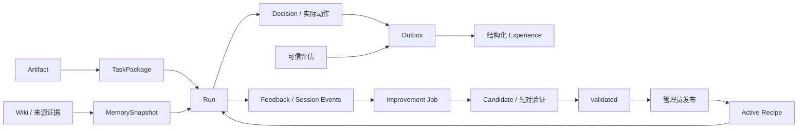

# CoSens RSI Workflow API 文档

更新时间：`2026-10-23`

接口实现版本：`1.0.0`；Python 包版本：`0.1.0`

代码基线：`codex/merge-rsi-memory`，服务代码提交 `ddfd1fc`

接口状态：当前本地 SQLite 服务的已实现接口。本文沿用 RSI Workflow API 设计稿的章节结构，路径、字段与行为以当前代码为准。

协议快照：[openapi.json](openapi.json)。它合并 RSI 主应用和挂载的私有 Memory 路由，并在 `x-mcp-tools` 中保存实际 MCP 工具 Schema。动态字典、鉴权、错误和生命周期语义由本文补充。

---

## 版本更新历史

| 日期 | 文档版本 | 更新内容 |
| --- | --- | --- |
| 2026-10-23 | 当前实现版 v2 | 逐接口补全 Path、Query、Header、Body 与 MCP arguments 参数表，以及共享嵌套对象字段说明。 |
| 2026-10-23 | 当前实现版 v1 | 根据服务实现整理 53 个 HTTP 操作、18 个 MCP 工具、Memory SDK 入口、任务与经验闭环。 |

---

## 1. 文档定位

本文面向 RSI 客户端、Agent 应用开发者、执行器接入者和服务运维人员。覆盖任务准备、执行指导、产物、反馈、结构化经验、候选改进、独立验证、管理员发布与业务追踪。

| API 类别 | 职责 | 当前入口与边界 |
| --- | --- | --- |
| RSI 业务 API | Run、指导、checkpoint、guided DAG、反馈、改进作业和 Case | `/v1/*`，使用 RSI 普通凭证 |
| 管理 API | 初始化 Recipe、可信评估、批准、发布及写回恢复 | `/internal/admin/v1/*`，使用独立管理员凭证 |
| 私有 Memory API | 知识检索、来源扩证、经验读写与 Recipe 学习视图 | `/memory/internal/v1/*`，使用 Memory 内部凭证；不向普通 Agent 暴露 |
| MCP | RSI 业务操作的工具映射 | HTTP `/mcp` 或本机 stdio；没有 Memory、管理员评估、发布工具 |
| Memory SDK | 普通 Agent 独立使用知识记忆 | Python `memory` 包；无需创建 RSI Run |

assist 模式由客户端 Agent 执行任务；guided 模式由服务按冻结 DAG 发放步骤，客户端执行并提交产物。准备 Run 不会自动运行模型。`managed` 在请求枚举中存在，但当前返回依赖不可用；后台 Recipe 学习所用的配置执行器与普通 Run 的 managed 模式是不同入口。

当前服务不提供模型代理、账户计费、支付、Run 自动 Token 账本或费用上限 API。Recipe 发布由管理员显式执行。

## 2. 领域模型

### 2.1 对象职责

| 对象 | 职责 | 不变量 |
| --- | --- | --- |
| `Artifact` | 输入材料、文本产物或评估报告 | 上传后内容不可变，按 ID 与返回的哈希引用 |
| `TaskPackage` | 目标、输入、交付约定、验收、环境和任务谱系 | 与 Run 一起保存；晚补输入另记补充记录，不能覆盖已冻结执行材料 |
| `Run` | assist/guided 任务实例 | 绑定准备时的 Recipe、知识快照和经验查询条件 |
| `MemorySnapshot` | Wiki、原文证据和可选 Recipe 经验 | 冻结内容；读取时仍校验引用来源的当前可用性 |
| `Recipe Bundle` | Flow、Step、绑定和检查约定 | 生产 active 记录归 RSI；候选保持在实验区 |
| `Decision` | 候选动作、推荐、实际动作和写回回执 | 推荐不等于执行；只能登记候选集合中的实际动作 |
| `Experience` | 状态、动作、结果、奖励及其版本 | 首次为 pending，可信评估才能追加 verified；不混入知识 Wiki |
| `Feedback` | Run 所有者的意见与纠错 | 不直接产生已验证奖励，不直接修改 active Recipe |
| `Improvement Job` | 准备、诊断、候选、筛选、确认和发布记录 | 验证与发布分开；材料/执行器/评审不足时持久化等待 |
| `Case` | 一组相关 Run 的业务展示 | 按身份、项目、任务族和显式 Case 标识分组，不凭标题猜测关联 |

### 2.2 资源关系



### 2.3 ID 与版本

ID 包括 `artifact_…`、`run_…`、`recipe_…`、`decision_…`、`job_…`、`approval_…`。Memory 普通来源 ID 与经验 ID 由其服务生成；内部 upsert 也允许受信任服务提交稳定 ID。

版本并发控制使用请求体中的 `expected_revision`，不实现 HTTP `ETag` / `If-Match`。哈希应使用服务返回值：RSI 和 Memory 的哈希格式、编码对象并不完全相同，不要把文本重新计算的裸 SHA-256 当成 Artifact 的 `content_hash`。

## 3. 基本约定

### 3.1 Base URL 与路由

默认客户端地址为 `http://127.0.0.1:18104`。本地启动脚本实际监听 `0.0.0.0:18104`；外部访问地址由部署入口决定。本文所有路径均相对于 Base URL。

| 方法与路径 | 鉴权 | 说明 |
| --- | --- | --- |
| `GET /health/live` | 无 | 存活检查，`200 {"status":"ok"}`，不检查 Memory |
| `GET /health/ready` | RSI | 检查 Memory、存储及配置，正常 `200`，依赖失败 `503` |
| `GET /` | 无 | `307` 跳转 `/dashboard` |
| `GET /dashboard`、`HEAD /dashboard` | 页面无 | HTML；数据查询仍需 RSI 凭证，`Cache-Control: no-store` |
| `GET /docs`、`GET /redoc`、`GET /openapi.json` | 无 | 主应用自动接口描述；不自动合并挂载的 Memory 接口 |
| `GET /memory/docs`、`GET /memory/redoc`、`GET /memory/openapi.json` | 描述页无 | Memory 子应用描述；业务路由继续校验内部凭证 |

`/health/ready` 返回 `status`、`storage`、`memory`、`trigger_policy`、`trigger_classifier`、`memory_outbox`、`harness_improvement`、`capabilities`。其中 `harness_improvement` 包含已配置任务族、通用准备能力及通用执行器版本。

表中的页面、跳转和自动描述入口均无 Path 变量、业务 Query 或请求体参数；MCP 的协议参数单独见 §11.1。

#### GET `/health/live`

| 参数 | 位置 | 类型 | 必填 | 默认值 | 说明 |
| --- | --- | --- | --- | --- | --- |
| `请求体` | Body | `无` | 否 | `—` | 无需发送请求体。 |

返回进程存活状态。

#### GET `/health/ready`

| 参数 | 位置 | 类型 | 必填 | 默认值 | 说明 |
| --- | --- | --- | --- | --- | --- |
| `Authorization` | Header | `string` | 是 | `—` | Bearer COSENS_RSI_TOKEN 对应凭证；见 §3.4。 |
| `请求体` | Body | `无` | 否 | `—` | 无需发送请求体。 |

检查依赖 readiness，返回字段见本节前面的说明。

### 3.2 Content-Type 与编码

各接口的参数表区分 Path、Query、Header 和 Body。必填指调用契约；对于开放字典 Body，业务必填字段不一定由 FastAPI 自动校验。默认值为 `—` 表示无可依赖的默认值，条件必填以说明列为准。

JSON 请求/响应使用 `application/json`、UTF-8；页面为 HTML。Recipe 下载仍返回 JSON，附 `Content-Disposition: attachment`。

Artifact 通过 JSON 文本上传，不支持 multipart、二进制上传、分块上传或预签名下载。服务没有统一 1 MiB 请求体限制；各字段/操作单独限制，见下文。使用 Pydantic 模型的接口默认不拒绝未知额外字段；客户端只应发送已定义字段。

### 3.3 时间、数值和哈希

- RSI 时间通常为 UTC ISO 8601 字符串；批准记录的 `expires` 是 Unix 秒，队列内部时间也可能为 Unix 秒。
- `revision`、`watermark` 为整数。经验回报是 `[-1,1]` 内有限数；候选 confidence/cost 是 `[0,1]` 内有限数。
- `confidence` 是候选偏好分数，不是已校准概率。`completed` 不证明任务质量已获独立接受。
- 金额和完整模型用量不是当前 Run API 的保证字段；不能从缺省字段推断零费用。

### 3.4 请求头与身份

| Header | 要求 | 当前行为 |
| --- | --- | --- |
| `Authorization` | 认证接口必填 | 精确匹配 `Bearer <对应凭证>` |
| `Content-Type` | JSON 写请求 | `application/json` |
| `Idempotency-Key` | prepare 必填；guidance/improvement 可选 | 仅相应操作使用，其他写路由不因该 Header 获得通用幂等能力 |

三种凭证分别由 `COSENS_RSI_TOKEN`、`COSENS_RSI_ADMIN_TOKEN`、`COSENS_MEMORY_INTERNAL_TOKEN` 配置。它们不是 Friday 账户 access token，也没有账户 introspection、动态 scope 或令牌刷新接口。

当前 HTTP/MCP 业务主体固定为 `local-codex`。Memory 内部主体、租户、项目由部署环境构造，且内部适配器使用管理员上下文。客户端不能通过请求中的 `principal`、`tenant_id` 等值改变认证身份；Recipe 经验接口中的 `principal` 只是受信任服务使用的业务范围参数。当前实现不能据此宣称团队级多租户认证已经完成。

### 3.5 成功响应与错误响应

已实现业务操作默认返回 `200`；后台作业创建也返回 `200` 和状态对象，不是 `202`。无 active Recipe 为 `200 {"status":"not_found","task_family":"…"}`。

Run guidance/checkpoint/submit/feedback/improvements 使用请求包装：

```json
{"data":{"summary":"具体业务字段"}}
```

prepare、Artifact、session-events、initial-inputs、guided submit、管理和 Memory 接口使用直接 JSON，不包 `data`。`JsonBody.data` 默认 `{}`，但各操作仍执行各自的业务校验。

错误响应尚未完全统一，客户端须识别以下形状：

| 来源 | 示例 |
| --- | --- |
| RSI 领域异常 | `{"error":{"code":"invalid_request","message":"…"}}` |
| RSI 认证/显式 HTTP 异常 | `{"detail":{"code":"unauthenticated","message":"…"}}` |
| FastAPI 字段校验 | `{"detail":[{"loc":["body","objective"],"type":"…","msg":"…"}]}` |
| MCP HTTP 认证中间件 | `{"error":"unauthenticated"}` |
| Memory 认证 | `{"detail":"unauthorized"}` |
| Memory 领域异常 | `{"error":"resource unavailable"}` 或 `{"error":"具体原因"}` |

不要依赖错误文案作为稳定机器契约。当前没有统一 `request_id`、`retryable`、`Retry-After` 响应头；字典请求缺字段也不保证都能归类为 422。

### 3.6 通用错误与重试

| HTTP | RSI 错误/场景 | Memory 错误/场景 |
| --- | --- | --- |
| 400 | prepare 缺少 `Idempotency-Key`，`detail.code=idempotency_key_required` | — |
| 401 | 普通/管理凭证无效 | 内部凭证无效 |
| 403 | `permission_denied`，例如无效或已消费的 attempt token | 当前项目/记录不可访问、主体不符 |
| 404 | `resource_not_found`；部分显式 HTTP 异常为字符串 detail | 读取目标不可用 |
| 409 | 当前 RSI 并发/幂等冲突通常不会映射到此状态 | 版本冲突、幂等内容不符或引用失效 |
| 422 | `invalid_request` 或框架字段校验；包括 RSI 幂等冲突、无效状态、发布前置条件不满足 | 参数错误 |
| 503 | `dependency_unavailable`；readiness 使用 `detail` 包装 | 子应用未统一映射此类依赖异常 |
| 500 | 未分类异常 | 未分类异常 |

相同 prepare 键在处理中可能返回 `200 {"status":"processing","retry_after_seconds":2}`。客户端据此稍后复用原键查询，不能把它当成已准备的 Run。已完成 prepare 相同键重放保存响应；请求或触发配置不符返回 422。

Artifact、结果提交、guided step 发放/提交、发布、批准不具有通用响应重放能力。超时后先读 Run/Decision/Job 状态，不盲目重试有副作用操作。

### 3.7 状态模型

| 对象 | 当前主要状态/返回值 |
| --- | --- |
| Run | `ready`、`completed`、`failed`；读取历史记录时可能出现其他保存状态，当前没有取消 API |
| prepare | `ready`、`processing`；approval 返回 `decision: approval_required` 与批准 ID |
| guided attempt | `pending`、`rejected`、`passed`；接口返回 `step_ready`、`repair_required`、`step_passed`、`all_steps_passed`、`failed` |
| Improvement Job | `queued`、`running`、`awaiting_input`、`awaiting_runner`、`awaiting_judge`、`awaiting_validation_tasks`、`validated`、`rejected`、`failed`、`deferred`、`published` |
| 经验奖励 | `pending`、`verified`、`inconclusive`、`retracted` |
| 决策 Memory outbox | `queued`、`running`、`retry_wait`、`done`、`failed` |
| 批准 | `pending`、`approved`；过期由 `expires` 判断 |

API 的 `200` 也可能表示 `repair_required`、`approval_required`、等待或无匹配。必须同时检查业务状态。

## Quick Start：准备、执行并查看一次 Run

示例使用 `curl`、`jq` 和 Python 3。凭证由运维提供；占位符不是可用凭证。默认 runtime 触发模式为 manual，显式 prepare 仍会执行。

```bash
export RSI_BASE_URL="http://127.0.0.1:18104"
export RSI_TOKEN="<RSI普通凭证>"
KEY="$(python3 -c 'import uuid; print(uuid.uuid4().hex)')"

# 1. 上传文本输入。Artifact 本身不会自动写成 Memory 知识。
ARTIFACT_JSON=$(curl --fail-with-body -sS "$RSI_BASE_URL/v1/artifacts" \
  -H "Authorization: Bearer $RSI_TOKEN" -H 'Content-Type: application/json' \
  -d '{"name":"source.txt","content":"项目负责人是 Alice。"}')
ARTIFACT_ID=$(printf '%s' "$ARTIFACT_JSON" | jq -r '.artifact_id')

# 2. prepare 返回 200；status=ready 表示上下文已准备，客户端继续执行。
RUN_JSON=$(curl --fail-with-body -sS "$RSI_BASE_URL/v1/runs/prepare" \
  -H "Authorization: Bearer $RSI_TOKEN" -H 'Content-Type: application/json' \
  -H "Idempotency-Key: prepare-$KEY" \
  -d "$(jq -n --arg artifact "$ARTIFACT_ID" '{
    objective:"根据输入材料生成一句摘要",task_family:"evidence-report",
    execution_mode:"assist",input_artifact_ids:[$artifact],
    deliverable:{format:"text"},acceptance:{require_source_refs:true}
  }')")
printf '%s\n' "$RUN_JSON"
RUN_ID=$(printf '%s' "$RUN_JSON" | jq -er 'select(.status=="ready")|.run_id')

# 3. 应用/Agent 根据自己的输入和返回上下文执行任务，提交结果。
curl --fail-with-body -sS "$RSI_BASE_URL/v1/runs/$RUN_ID/submit" \
  -H "Authorization: Bearer $RSI_TOKEN" -H 'Content-Type: application/json' \
  -d '{"data":{"summary":"项目负责人为 Alice。"}}'

# 4. 读取状态与追踪。completed 的 evaluation 仍是 inconclusive。
curl --fail-with-body -sS "$RSI_BASE_URL/v1/runs/$RUN_ID" \
  -H "Authorization: Bearer $RSI_TOKEN"
curl --fail-with-body -sS "$RSI_BASE_URL/v1/runs/$RUN_ID/trace" \
  -H "Authorization: Bearer $RSI_TOKEN"
```

若 prepare 返回批准请求，需管理员批准后使用其返回的 Run；若返回 processing，复用原键等待。示例中的验收声明用于记录和后续标准编译，不表示普通 assist 提交会自动调用独立评审。

## 4. 公共对象模型

### 4.1 TaskPackage / PrepareBody

| 字段 | 类型 | 必填/默认 | 校验与语义 |
| --- | --- | --- | --- |
| `objective` | string | 是 | 非空，最多 20,000 字符；领域层去首尾空白 |
| `task_family` | string | `general` | Recipe、任务和经验的适用范围 |
| `task_lineage_id` | string/null | null | 非空时最多 256 字符，显式关联同一任务谱系 |
| `input_artifact_ids` | string[] | `[]` | 最多 100 个、无重复，必须是当前主体可读的已存 Artifact |
| `deliverable` | object | `{}` | 交付约定；执行器需要的可修改输入等由对应契约解析 |
| `acceptance` | object | `{}` | 验收声明；结构化 checks 可供后台编译，不是客户端自证通过 |
| `execution_mode` | string | `assist` | assist/guided；managed 当前不可用 |
| `requires_evidence` | boolean | false | 请求准备时按需增加原文证据；不在保存的 TaskPackage 中作为同名字段返回 |
| `environment` | object | `{}` | 规范化 JSON 最多 8000 字符；属于经验兼容性条件，Case 可用 case_id/case_title 分组 |

模型、工具、任意命令、active Recipe 覆盖和费用预算不是当前 prepare 的参数。后台执行配置由部署者设置。

### 4.2 Run

`GET /v1/runs/{run_id}` 的字段：

| 字段 | 类型 | 说明 |
| --- | --- | --- |
| `run_id`、`status`、`execution_mode` | string | 当前任务身份和状态 |
| `task_package`、`task_package_hash` | object / string | 冻结任务及哈希 |
| `recipe_id`、`recipe_revision` | string/null、integer/null | 准备时绑定的 Recipe；没有匹配时可为空 |
| `snapshot`、`snapshot_hash` | object / string | 完整知识快照及其哈希 |
| `checkpoint` | object | 最近保存的任务进度，包含服务拥有的 guided 进度 |
| `result` | object/null | 已提交结果或 guided 最终结果 |

### 4.3 MemorySnapshot

保存对象包含 `schema_version:1`、`profile`、`query`、`created_at`、`wiki`、`evidence`、`coverage`、`sufficiency`、`experience_context`；启用 Recipe Memory 时另有 `recipe_memory`。`sufficiency` 当前为 unknown/partial，不提供“证据已完整”的保证。

prepare 的返回是摘要 `context`：`snapshot_id`、`hash`、`sufficiency`、`wiki`、`evidence` 及可选 `recipe_memory`；完整对象从 Run 读取。`snapshot_id` 是由哈希派生的标识，没有单独 Snapshot CRUD API。

### 4.4 CandidateAction 与 Decision

| CandidateAction 字段 | 类型 | 约束 |
| --- | --- | --- |
| `id` | string | 必填、非空、最多 128 字符，同批唯一 |
| `version` | string | 默认 `1`，非空、最多 128 字符 |
| `description` | string | 必填、非空、最多 4,000 字符 |
| `confidence` | number | 默认 0.5，有限数 `[0,1]` |
| `cost` | number | 默认 0，有限数 `[0,1]`，归一化成本，不是账单金额 |

候选集合为 1–8 个。动作签名包含 id/version/description，改变动作语义应更新描述或版本。Decision 的排序结果包含 `recommended_action_id`、`experience_recommended_action_id`、`selection_mode`、`scores`、`policy_version`、`mechanism`、`recommendation_only`、`cold_start` 和解释。

每个 score 包含 action_id/base_score/score/q/advantage/independent_tasks/support/experience_refs。无可用经验时 q 可为 null；不能把未尝试动作当作已知成功。

### 4.5 Artifact 与 SourceRef

Artifact 返回 `artifact_id`、`name`、`content_hash`、`size_bytes`。文本 UTF-8 最多 1,000,000 字节；名称会截取为最多 256 字符。

SourceRef 为 `{source_id,revision,start,end,content_hash}`，start/end 是来源文本的字符位置，范围为 `[start,end)`。来源哈希、版本、权限或片段无效时不能继续作为有效证据。

### 4.6 Recipe Bundle

Bundle 包含 `schema:"hierarchical-recipe-1"`、`flow`、`steps`、`bindings`。Flow 定义有序 DAG 节点、输入绑定、final 和检查；Step 定义输入/输出类型和 body；bindings 把 skill 名绑定到不可变 Step 引用。guided 输出端口类型仅支持 `text` 与 `artifacts`。

最小完整示例见 [recipe-v1.json](../business_cases/refund_recipe_quality/recipe-v1.json)，结构校验以 `freeze_bundle()` 为准。不能把 Recipe 文本当作放宽工具、凭证或用户授权的依据。

Bundle 入参逐字段定义如下，均相对于 `bundle`：

| 字段 | 类型 | 必填/默认 | 参数说明 |
| --- | --- | --- | --- |
| `schema` | `string` | 是 | 固定为 hierarchical-recipe-1 |
| `flow` | `object` | 是 | Flow 定义，各字段见本表 |
| `steps` | `object<string, Step>` | 是 | 非空映射，键为 step.id@step.version，不可省略版本 |
| `bindings` | `object<string, string>` | 是 | skill 名到 steps 键的映射，不允许悬空引用 |
| `flow.id / flow.version` | `string` | 是 | Flow 标识和版本，均为非空文本 |
| `flow.nodes` | `Node[]` | 是 | 1–12 个节点，依赖必须构成无环图 |
| `flow.final` | `string` | 是 | 最终交付端口，格式为 node_id.output_port |
| `flow.checks` | `string[]` | 是 | Flow 检查声明，可为空数组，每项非空 |
| `steps.<ref>.id / version` | `string` | 是 | Step 标识/版本，必须与映射键对应 |
| `steps.<ref>.inputs / outputs` | `object<string, string>` | 是 | 非空端口映射；端口类型只能为 text 或 artifacts |
| `steps.<ref>.body` | `object` | 是 | 只包含 preconditions/steps/checks/recovery 四个声明槽位 |
| `steps.<ref>.body.preconditions / checks / recovery` | `string[]` | 是 | 前置条件、检查和恢复声明，允许空数组，每项非空 |
| `steps.<ref>.body.steps` | `string[]` | 是 | 执行方法声明，至少一项且每项非空 |
| `flow.nodes[].id` | `string` | 是 | Flow 内唯一、非空的节点 ID |
| `flow.nodes[].goal` | `string` | 是 | 节点目标，去空白后非空 |
| `flow.nodes[].skill` | `string` | 是 | 已存在的 bindings 键 |
| `flow.nodes[].inputs` | `object<string, string>` | 是 | 必须覆盖对应 Step 所有输入端口；值为 $task 或上游 node.port，端口类型须一致 |
| `flow.nodes[].after` | `string[]` | 是 | 显式前置节点，可为空；引用必须存在且不得自依赖 |
| `flow.nodes[].max_repairs` | `integer` | 是 | 只能为 0 或 1，允许的本地修复次数 |

Bundle、Flow、Step、Node 及 Step body 使用固定字段集合校验；不能在其中附加任意配置字段。本文出现的 `<ref>`、`[]` 是字段路径说明，不是实际 JSON 键。


### 4.7 Improvement Job

查询响应包含 `job_id`、`run_id`、`status`、`request`、`report`、`error`。report 在准备前可为 null；后台完成某阶段后包含诊断、manifest、候选、比较及 release_decision。通用流程还包含 `schema:generic-improvement-v1`、stage、reason、evidence_level、preparation、manifest_generations、runtime/checkpoint 哈希。

客户端用 `status` 和 report 的实际缺口判断下一步，不根据“有候选”推断已验证或已发布。

### 4.8 共享嵌套参数：材料、事件与验收

`ArtifactRef` 用于 guided artifacts 端口与应用结果引用：

| 字段 | 类型 | 必填/默认 | 参数说明 |
| --- | --- | --- | --- |
| `artifact_id` | `string` | 是 | 上传返回的 Artifact ID，guided 校验时必须归当前主体 |
| `content_hash` | `string` | 是 | 上传返回的不可变内容哈希，须原样引用 |

`SourceRef` 用于 evidence/expand 和经验中的来源证据；不能用 ArtifactRef 替代：

| 字段 | 类型 | 必填/默认 | 参数说明 |
| --- | --- | --- | --- |
| `source_id` | `string` | 是 | Memory 来源 ID |
| `revision` | `integer` | 是 | 来源版本，必须匹配当前可用版本 |
| `start` | `integer` | 是 | 文本片段起始字符位置，包含该位置，至少 0 |
| `end` | `integer` | 是 | 文本片段结束字符位置，不包含该位置；必须大于 start 且不超过正文字符数 |
| `content_hash` | `string` | 是 | 对应来源版本返回的哈希，必须匹配 |

`SessionEvent` 用于 session-events/events 工具参数：

| 字段 | 类型 | 必填/默认 | 参数说明 |
| --- | --- | --- | --- |
| `id` | `string` | 是 | 稳定事件 ID，非空且最多 256 字符；同 ID 只能重放相同完整事件 |
| `kind` | `string` | 是 | user_prompt/agent_action/tool_result/context_delivery/correction/artifact/session_end |
| `payload` | `object` | 是 | 对应事件的可观测内容，由应用按 kind 组织；不是可信专家身份或完整遥测声明 |

TaskPackage 的 deliverable/acceptance/environment 为开放对象。下面列出服务实际读取的约定字段；其他字段作为应用声明保存，不获得隐含执行语义：

| 字段 | 类型 | 必填/默认 | 参数说明 |
| --- | --- | --- | --- |
| `deliverable.format` | `string` | 否 | 应用声明的交付格式，如 text；不自动强制格式验收 |
| `deliverable.requires_files` | `boolean` | 否，缺省不启用 | 通用准备要求有真实初始文件材料；缺少时等待补充 |
| `acceptance.checks` | `AcceptanceCheck[]` | 否 | 后台可编译的明确检查声明；传入后不代表普通 assist submit 自动独立评估 |
| `acceptance.require_source_refs` | `boolean` | 否 | 应用记录的引用要求，普通 assist submit 不据此自动验收 |
| `environment.case_id` | `string` | 否 | 显式 Case 分组标识，相同身份/项目/任务族下生效 |
| `environment.case` | `string` | 否 | 兼容的 Case 分组字段；优先使用 case_id |
| `environment.case_title` | `string` | 否 | Case 展示标题，不代替分组 ID |

`AcceptanceCheck` 同时适用于 acceptance.checks 和 feedback.acceptance_checks：

| 字段 | 类型 | 必填/默认 | 参数说明 |
| --- | --- | --- | --- |
| `kind` | `string` | 是 | exists/contains/json_equal/json_field_equal/numeric_equal |
| `path` | `string` | 是 | 被检查的输出文件相对路径，不能绝对路径或越过工作目录 |
| `value` | `JSON value` | 非 exists 时必填 | contains 为非空字符串；numeric_equal 为有限数；JSON 检查为明确期望值 |
| `field` | `(string/integer)[]` | kind=json_field_equal 时必填 | JSON 字段路径，例如 ["total"] 或 ["items",0,"price"] |
| `tolerance` | `number` | 否，0 | numeric_equal 的绝对容差，有限且非负 |
| `key` | `string` | 否，criterion-序号 | 本次检查集合内唯一、非空的检查标识 |
| `title` | `string` | 否，使用 key | 检查名称 |
| `critical` | `boolean` | 否，true | 是否关键成功条件 |
| `weight` | `number` | 否，1 | 有限正权重 |
| `source_refs` | `string[]` | 服务编译时绑定 | 标准编译器从任务或纠错来源生成的声明引用，不是 Memory SourceRef；客户端不能自行填一个引用就证明来源有效 |

编译时检查集合为 1–100 项；来源绑定、独立评审和矛盾检查仍会执行。无法编译的声明使改进作业等待 judge，不修改已提交 Run 的验收结论。

### 4.9 Recipe 评估、发布与经验引用参数

`RecipeEvaluation` 用于管理员 recipe-evaluation 的 record 和 Memory observe 的普通评估 record：

| 字段 | 类型 | 必填/默认 | 参数说明 |
| --- | --- | --- | --- |
| `evaluation_id` | `string` | 是 | 该次可信评估的稳定标识，用于观察幂等 |
| `task_id` | `string` | 是 | 被评估任务 ID，与训练视图的 task_ids 对应 |
| `task_lineage_id` | `string` | 是 | 被评估任务谱系，供暴露及隔离审计使用 |
| `task_sha256` | `string` | 是 | 冻结任务内容摘要 |
| `bundle_sha256` | `string` | 是 | 实际执行的冻结 Recipe Bundle 摘要 |
| `protocol_sha256` | `string` | 是 | 本次比较/评审协议摘要 |
| `session_sha256` | `string` | 是 | 实际执行会话证据摘要 |
| `task_prompt` | `string` | 是 | 冻结任务目标正文；管理员入口要求等于 Run 目标 |
| `judge_valid` | `boolean` | 是 | 可信评估者是否认为该评审有效；必须为 true 才映射 verified 奖励 |
| `score` | `number` | 是 | 评估得分；有效评审使用 [0,1]，映射成 [-1,1]；无有效 judge 时不产生已验证回报 |
| `task_success` | `boolean` | 是 | 任务成功结论，随评估证据保存 |
| `其他审计字段` | `JSON value` | 否 | 受信任适配器的附加证据；不允许顶层 tests/expected/reference_answer 混入学习材料 |

Memory observe 检查必需键和后续经验约束，并不独立证明外部哈希、评审结论或任务成功；正确类型和可信评估报告由调用服务负责。管理员 recipe-evaluation 另执行 Artifact、哈希、目标与 Bundle 绑定。

`RecipeRelease` 仅用于 Memory observe 的 production record：

| 字段 | 类型 | 必填/默认 | 参数说明 |
| --- | --- | --- | --- |
| `kind` | `string` | 是 | 固定 release，以此区别普通评估记录 |
| `decision` | `string` | 是 | 固定 accepted，必须来自可信发布流程 |
| `recipe_id` | `string` | 是 | 已发布 Recipe 标识 |
| `bundle_hash` | `string` | 是 | 已发布 Recipe Bundle 哈希，运行时 recall 必须匹配 |
| `objective` | `string` | 是 | 这次发布改进所针对的目标/经验描述 |
| `task_lineage_id` | `string` | 否，使用 source_run_id | 发布经验的任务谱系 |
| `diagnosis / changes 等附加字段` | `JSON value` | 否 | 发布诊断、修改说明及可信审计内容，随发布经验保存 |

`RecipeExperienceRef` 是 learning-view 的 references 元素：

| 字段 | 类型 | 必填/默认 | 参数说明 |
| --- | --- | --- | --- |
| `experience_id` | `string` | 是 | 经验 ID，引用集合内不得重复 |
| `revision` | `integer` | 是 | 经验版本，至少 1，且仍为当前版本 |
| `content_hash` | `string` | 是 | 该经验版本返回的内容哈希 |
| `record_hash` | `string` | 是 | observe 返回的原始评估 record 哈希，读取时重新核对 |

### 4.10 结构化经验与可信结果参数

`ExperienceRecord` 用于 experiences/upsert 的 record。整个对象规范化 JSON 最多 128,000 字符：

| 字段 | 类型 | 必填/默认 | 参数说明 |
| --- | --- | --- | --- |
| `run_id` | `string` | 是 | 产生经历的 Run，非空且最多 256 字符 |
| `task_family` | `string` | 是 | 适用任务族，非空且最多 256 字符 |
| `phase` | `string` | 是 | 发生阶段，非空且最多 256 字符，如 assist/recipe-learning |
| `action_schema` | `string` | 是 | 候选动作协议，非空且最多 256 字符 |
| `reward_spec` | `string` | 是 | 奖励规范，非空且最多 256 字符；追加 outcome 必须一致 |
| `state` | `object` | 是 | 动作执行前的情境；检索优先使用 observation 或 objective 文本，其他结构按 JSON 参与相似性计算 |
| `environment` | `object` | 否，{} | 执行环境，检索按摘要精确匹配 |
| `contract_hash` | `string` | 否，unscoped | 非空执行合同摘要，用于限制兼容经验范围 |
| `candidates` | `CandidateAction[]` | 是 | 1–8 个候选；每项字段、默认值与长度限制见 §4.4 |
| `actual_action_id` | `string` | 是 | 实际执行动作，必须属于 candidates |
| `partition` | `string` | 否，production | production/train/screen/confirm/held_out；普通运行时检索不扩展到验证分区 |
| `source_refs` | `SourceRef[]` | 否，[] | 最多 32 个当前有效来源引用，结构见 §4.8 |
| `next_state` | `object` | 否 | 后继观察，随经验保存；不代表已验证成功 |
| `task_lineage_id` | `string` | 否 | 应用记录的任务谱系 |
| `recipe_id / recipe_revision` | `string / integer` | 否 | 产生经历时采用的 Recipe 与版本 |
| `policy_version` | `string` | 否 | 产生动作建议的策略版本 |
| `其他上下文字段` | `JSON value` | 否 | 作为经历扩展信息保存，不改变权限、检索分区或奖励认证 |
| `action / action_signature / outcome` | `服务生成` | 不接受自证 | 动作和签名由候选计算；outcome 强制重置为 pending/value=null，已有奖励随修订失效 |

可选上下文字段为应用约定，Memory 不为所有扩展字段提供独立类型校验。SourceRef 和候选动作仍执行各自完整校验。

`ExperienceOutcome` 用于 experiences/{experience_id}/outcomes 的 outcome，规范化 JSON 最多 32,000 字符：

| 字段 | 类型 | 必填/默认 | 参数说明 |
| --- | --- | --- | --- |
| `evaluation_id` | `string` | 是 | 可信评估标识，去空白后不可空 |
| `reward_spec` | `string` | 是 | 必须与经验记录使用的奖励规范一致，去空白后不可空 |
| `status` | `string` | 是 | verified/inconclusive/retracted |
| `value` | `number/null` | status=verified 时必填 | verified 要求有限数 [-1,1]，其他状态强制为 null |
| `evidence_ref` | `string` | 是 | 可信评估报告或审计证据标识，去空白后不可空；Memory 不代替宿主验证报告含义 |
| `evidence_content_hash` | `string` | 否 | 宿主保留的评估报告哈希，Memory 不直接读取外部报告校验 |
| `source_refs` | `SourceRef[]` | 否，[] | 最多 32 项来源引用，追加和读取时校验当前可用性 |
| `其他审计字段` | `JSON value` | 否 | 额外可信结果材料，不改变奖励规范匹配或版本并发要求 |


## 5. 公共业务 API

本节均使用 RSI 普通凭证。Path 中的资源 ID 为必填字符串，必须来自服务响应。

### 5.1 触发判断与任务准备

#### POST `/v1/trigger/decide`

| 参数 | 位置 | 类型 | 必填 | 默认值 | 说明 |
| --- | --- | --- | --- | --- | --- |
| `Authorization` | Header | `string` | 是 | `—` | Bearer COSENS_RSI_TOKEN 对应凭证；见 §3.4。 |
| `Content-Type` | Header | `string` | 是 | `"application/json"` | JSON 请求编码。 |
| `(请求体)` | Body | `object` | 是 | `—` | 以下 Body 字段位于该 JSON 对象中；嵌套字段用点号表示。 |
| `objective` | Body | `string` | 是 | `—` | 任务目标，非空，最多 20,000 字符；准备时去首尾空白。 |
| `task_family` | Body | `string` | 否 | `"general"` | 任务族，用于查找 active Recipe、范围隔离及经验兼容匹配。 |
| `task_lineage_id` | Body | `string/null` | 否 | `null` | 任务谱系标识；非 null 时非空且最多 256 字符，用于关联同源任务。 |
| `input_artifact_ids` | Body | `string[]` | 否 | `[]` | 已经上传且当前主体可读的初始材料 ID，最多 100 项且不重复。 |
| `deliverable` | Body | `object` | 否 | `{}` | 交付约定；由应用和后台任务编译器解释，不授予额外工具权限。 |
| `acceptance` | Body | `object` | 否 | `{}` | 验收声明；checks 的结构见 §4.8，不代表客户端自证通过。 |
| `execution_mode` | Body | `string` | 否 | `"assist"` | assist 或 guided；枚举中的 managed 当前返回依赖不可用。 |
| `requires_evidence` | Body | `boolean` | 否 | `false` | 是否在准备上下文时按需扩展原文证据。 |
| `environment` | Body | `object` | 否 | `{}` | 运行环境与经验兼容范围；规范化 JSON 最多 8,000 字符。case_id/case_title 可用于 Case 分组。 |

Body 为 §4.1 PrepareBody。只调用 `decide_trigger(explicit=false)`，不创建 Run、批准记录或检索 Memory。auto 模式配置了分类器时可能调用该分类器。

返回 decision 为 execute/do_not_trigger/approval_required，并附 reason、prompt_version，部分模式另有 classifier。manual 下此接口返回 do_not_trigger；业务 prepare 是显式请求，不受这个结果等价替代。

#### POST `/v1/runs/prepare`

| 参数 | 位置 | 类型 | 必填 | 默认值 | 说明 |
| --- | --- | --- | --- | --- | --- |
| `Authorization` | Header | `string` | 是 | `—` | Bearer COSENS_RSI_TOKEN 对应凭证；见 §3.4。 |
| `Idempotency-Key` | Header | `string` | 是 | `—` | 任务准备幂等键，非空；重试必须同键同内容，不从 Body 读取此键。 |
| `Content-Type` | Header | `string` | 是 | `"application/json"` | JSON 请求编码。 |
| `(请求体)` | Body | `object` | 是 | `—` | 以下 Body 字段位于该 JSON 对象中；嵌套字段用点号表示。 |
| `objective` | Body | `string` | 是 | `—` | 任务目标，非空，最多 20,000 字符；准备时去首尾空白。 |
| `task_family` | Body | `string` | 否 | `"general"` | 任务族，用于查找 active Recipe、范围隔离及经验兼容匹配。 |
| `task_lineage_id` | Body | `string/null` | 否 | `null` | 任务谱系标识；非 null 时非空且最多 256 字符，用于关联同源任务。 |
| `input_artifact_ids` | Body | `string[]` | 否 | `[]` | 已经上传且当前主体可读的初始材料 ID，最多 100 项且不重复。 |
| `deliverable` | Body | `object` | 否 | `{}` | 交付约定；由应用和后台任务编译器解释，不授予额外工具权限。 |
| `acceptance` | Body | `object` | 否 | `{}` | 验收声明；checks 的结构见 §4.8，不代表客户端自证通过。 |
| `execution_mode` | Body | `string` | 否 | `"assist"` | assist 或 guided；枚举中的 managed 当前返回依赖不可用。 |
| `requires_evidence` | Body | `boolean` | 否 | `false` | 是否在准备上下文时按需扩展原文证据。 |
| `environment` | Body | `object` | 否 | `{}` | 运行环境与经验兼容范围；规范化 JSON 最多 8,000 字符。case_id/case_title 可用于 Case 分组。 |

Body 为 §4.1，Header `Idempotency-Key` 必填。正常 `200`：

```json
{
  "run_id":"run_example","status":"ready","execution_mode":"assist",
  "task_package":{"objective":"生成摘要","task_family":"general","input_artifact_ids":[],"deliverable":{},"acceptance":{},"environment":{}},
  "task_package_hash":"sha256:example",
  "recipe":{"status":"not_found","task_family":"general"},
  "context":{"snapshot_id":"snapshot_example","hash":"sha256:example","sufficiency":"unknown","wiki":[],"evidence":[]}
}
```

服务选择 active Recipe、准备经验水位、检索 Wiki 并在需要时扩展证据，随后保存 Run。没有 Recipe 仍可准备 assist；guided 后续需要有效冻结 Recipe。approval 模式返回 `decision`、`approval_id`、`expires_in_seconds:900`、`scope_hash`、`reason`，此时尚未检索 Memory。

### 5.2 读取 Run

#### GET `/v1/runs/{run_id}`

| 参数 | 位置 | 类型 | 必填 | 默认值 | 说明 |
| --- | --- | --- | --- | --- | --- |
| `run_id` | Path | `string` | 是 | `—` | 目标 Run ID，必须属于当前调用主体。 |
| `Authorization` | Header | `string` | 是 | `—` | Bearer COSENS_RSI_TOKEN 对应凭证；见 §3.4。 |
| `请求体` | Body | `无` | 否 | `—` | 无需发送请求体。 |

返回 §4.2。会重新校验保存快照中的来源引用；不重新做相关性搜索。来源或 Memory 不可用可能使读取失败，冻结快照不是绕过撤销的授权副本。

#### GET `/v1/runs`

| 参数 | 位置 | 类型 | 必填 | 默认值 | 说明 |
| --- | --- | --- | --- | --- | --- |
| `limit` | Query | `integer` | 否 | `100` | 最多返回多少项；服务将取值限制在 1–200，无游标。 |
| `Authorization` | Header | `string` | 是 | `—` | Bearer COSENS_RSI_TOKEN 对应凭证；见 §3.4。 |
| `请求体` | Body | `无` | 否 | `—` | 无需发送请求体。 |

Query `limit:integer=100`，服务限制为 1–200，按创建时间倒序；无游标分页。返回 `{"items":[…]}`。每项包含 run_id、objective、task_family、status、execution_mode、recipe_id、recipe_revision、created_at、updated_at；不包含完整快照。

### 5.3 Run 事件与 Trace

#### GET `/v1/runs/{run_id}/events`

| 参数 | 位置 | 类型 | 必填 | 默认值 | 说明 |
| --- | --- | --- | --- | --- | --- |
| `run_id` | Path | `string` | 是 | `—` | 目标 Run ID，必须属于当前调用主体。 |
| `Authorization` | Header | `string` | 是 | `—` | Bearer COSENS_RSI_TOKEN 对应凭证；见 §3.4。 |
| `请求体` | Body | `无` | 否 | `—` | 无需发送请求体。 |

返回 `{"items":[{"sequence":1,"type":"prepared","data":{},"created_at":"2026-10-23T00:00:00+00:00"}]}`。sequence 在 Run 内递增，从 1 开始。当前返回完整事件列表；无 after/next_cursor、SSE 或订阅接口。

#### GET `/v1/runs/{run_id}/trace`

| 参数 | 位置 | 类型 | 必填 | 默认值 | 说明 |
| --- | --- | --- | --- | --- | --- |
| `run_id` | Path | `string` | 是 | `—` | 目标 Run ID，必须属于当前调用主体。 |
| `Authorization` | Header | `string` | 是 | `—` | Bearer COSENS_RSI_TOKEN 对应凭证；见 §3.4。 |
| `请求体` | Body | `无` | 否 | `—` | 无需发送请求体。 |

返回 `{run,events,learning,decisions}`。learning 是冻结经验上下文，decisions 是各决策及其回执。不是完整模型推理、Token 或费用明细接口；没有 after/cursor 参数或独立 trace scope。

### 5.4 补充输入与捕获事件

#### POST `/v1/runs/{run_id}/initial-inputs`

| 参数 | 位置 | 类型 | 必填 | 默认值 | 说明 |
| --- | --- | --- | --- | --- | --- |
| `run_id` | Path | `string` | 是 | `—` | 目标 Run ID，必须属于当前调用主体。 |
| `Authorization` | Header | `string` | 是 | `—` | Bearer COSENS_RSI_TOKEN 对应凭证；见 §3.4。 |
| `Content-Type` | Header | `string` | 是 | `"application/json"` | JSON 请求编码。 |
| `(请求体)` | Body | `object` | 是 | `—` | 以下 Body 字段位于该 JSON 对象中；嵌套字段用点号表示。 |
| `artifact_ids` | Body | `string[]` | 是 | `—` | 补充的原始输入 Artifact ID，1–100 项，无重复且当前主体可读；材料冻结后拒绝。 |

直接 Body：`{"artifact_ids":["artifact_example"]}`，1–100 个、无重复、当前主体可读的 Artifact ID。只补充初始材料，不把最终答案当作输入，不重写原 TaskPackage。进入执行材料冻结后拒绝，需准备新 Run。

返回 `{"run_id":"run_example","status":"supplied","basis":"supplemented_materials_not_historical_snapshot"}`；可唤醒当前主体的等待作业。

#### POST `/v1/runs/{run_id}/session-events`

| 参数 | 位置 | 类型 | 必填 | 默认值 | 说明 |
| --- | --- | --- | --- | --- | --- |
| `run_id` | Path | `string` | 是 | `—` | 目标 Run ID，必须属于当前调用主体。 |
| `Authorization` | Header | `string` | 是 | `—` | Bearer COSENS_RSI_TOKEN 对应凭证；见 §3.4。 |
| `Content-Type` | Header | `string` | 是 | `"application/json"` | JSON 请求编码。 |
| `(请求体)` | Body | `object` | 是 | `—` | 以下 Body 字段位于该 JSON 对象中；嵌套字段用点号表示。 |
| `events` | Body | `SessionEvent[]` | 是 | `—` | 可观测会话事件，1–200 项，总 JSON UTF-8 最多 1,000,000 字节；逐项字段见 §4.8。 |

直接 Body：

```json
{"events":[{"id":"tool-001","kind":"tool_result","payload":{"tool":"tests","exit_code":0}}]}
```

events 为 1–200 项，总 JSON UTF-8 最多 1,000,000 字节。每项 id 非空且最多 256 字符；payload 为对象；kind 为 user_prompt/agent_action/tool_result/context_delivery/correction/artifact/session_end。稳定 ID 与相同内容重试不重复写入；同 ID 不同内容返回 422。

返回 `{"run_id":"run_example","durable_ack":["tool-001"],"coverage":"observable_events"}`。成功 ACK 仅证明可观测记录持久化，不证明完整遥测或专家权威。该写入只依赖本地 Run 授权，不要求 Memory 在线。

### 5.5 上传 Artifact

#### POST `/v1/artifacts`

| 参数 | 位置 | 类型 | 必填 | 默认值 | 说明 |
| --- | --- | --- | --- | --- | --- |
| `Authorization` | Header | `string` | 是 | `—` | Bearer COSENS_RSI_TOKEN 对应凭证；见 §3.4。 |
| `Content-Type` | Header | `string` | 是 | `"application/json"` | JSON 请求编码。 |
| `(请求体)` | Body | `object` | 是 | `—` | 以下 Body 字段位于该 JSON 对象中；嵌套字段用点号表示。 |
| `name` | Body | `string` | 是 | `—` | 产物名称，去空白后非空，最多保存 256 字符。 |
| `content` | Body | `string` | 是 | `—` | 产物文本，非空，UTF-8 最多 1,000,000 字节。 |

直接 Body：`{"name":"report.md","content":"# 报告\n正文"}`。两者按字符串发送；内容和名称不可空，限制见 §4.5。成功返回 Artifact 对象。

无通用上传幂等、列表、按任意 Artifact ID 下载或删除 API。Case 关联的产物可通过 §9 的 Case 接口读取；重复上传生成新 ID。

### 5.6 获取指导与登记实际动作

#### POST `/v1/runs/{run_id}/guidance`

| 参数 | 位置 | 类型 | 必填 | 默认值 | 说明 |
| --- | --- | --- | --- | --- | --- |
| `run_id` | Path | `string` | 是 | `—` | 目标 Run ID，必须属于当前调用主体。 |
| `Authorization` | Header | `string` | 是 | `—` | Bearer COSENS_RSI_TOKEN 对应凭证；见 §3.4。 |
| `Idempotency-Key` | Header | `string` | 否 | `—` | 本操作幂等键，最多 256 字符；优先于 Body 键，重试保持同键同内容。 |
| `Content-Type` | Header | `string` | 是 | `"application/json"` | JSON 请求编码。 |
| `(请求体)` | Body | `object` | 是 | `—` | 以下 Body 字段位于该 JSON 对象中；嵌套字段用点号表示。 |
| `data` | Body | `object` | 否 | `{}` | 指导请求包装对象。 |
| `data.observation` | Body | `string` | 否 | `""` | 当前观察；候选评分时最多 12,000 字符。 |
| `data.candidates` | Body | `CandidateAction[]/null` | 否 | `null` | 提供时进入经验评分，必须 1–8 项；字段及默认值见 §4.4。省略时读取冻结指导。 |
| `data.node_id` | Body | `string/null` | 条件必填 | `null` | guided 评分必须是当前已发放节点；assist 不接受指定节点。 |
| `data.request_key` | Body | `string/null` | 否 | `null` | 候选评分幂等键，最多 256 字符；Header Idempotency-Key 优先，省略按请求摘要生成。 |

无 candidates 时返回 guidance、memory_context、next_action 等冻结上下文。带 candidates 时要求 Run 为 ready，返回 decision_id、state、candidates、decision、execution_hints、additional_evidence、memory_context、experience_watermark、contract_hash、retrieval_profile、context_hash 等。

```json
{"data":{"observation":"接口返回结构校验失败","candidates":[
  {"id":"retry","version":"1","description":"重试请求","confidence":0.7,"cost":0.1},
  {"id":"inspect","version":"1","description":"检查响应结构","confidence":0.6,"cost":0.1}
]}}
```

同一评分请求键同内容返回已存决策；不同内容返回 422。省略键时以观察、候选、节点和 checkpoint 的摘要去重。服务器给出的建议不会自动执行动作。

#### GET `/v1/runs/{run_id}/decisions/{decision_id}`

| 参数 | 位置 | 类型 | 必填 | 默认值 | 说明 |
| --- | --- | --- | --- | --- | --- |
| `run_id` | Path | `string` | 是 | `—` | 目标 Run ID，必须属于当前调用主体。 |
| `decision_id` | Path | `string` | 是 | `—` | 该 Run 内的决策 ID。 |
| `Authorization` | Header | `string` | 是 | `—` | Bearer COSENS_RSI_TOKEN 对应凭证；见 §3.4。 |
| `请求体` | Body | `无` | 否 | `—` | 无需发送请求体。 |

返回 `decision_id`、`recommendation`、`actual`、`experience:{experience_id,revision}`、`writes`。actual 在尚未登记时为 null；每个 write 包含 id/kind/state/attempts/last_error/receipt_json。receipt_json 是保存的 JSON 字符串，未投递时可为 null。

#### POST `/v1/runs/{run_id}/checkpoint`

| 参数 | 位置 | 类型 | 必填 | 默认值 | 说明 |
| --- | --- | --- | --- | --- | --- |
| `run_id` | Path | `string` | 是 | `—` | 目标 Run ID，必须属于当前调用主体。 |
| `Authorization` | Header | `string` | 是 | `—` | Bearer COSENS_RSI_TOKEN 对应凭证；见 §3.4。 |
| `Content-Type` | Header | `string` | 是 | `"application/json"` | JSON 请求编码。 |
| `(请求体)` | Body | `object` | 是 | `—` | 以下 Body 字段位于该 JSON 对象中；嵌套字段用点号表示。 |
| `data` | Body | `object` | 否 | `{}` | 要完整保存的 checkpoint，规范化 JSON 最多 16,000 字符，不是增量 merge；不得传 guided_index/guided_outputs。 |
| `data.decision_id` | Body | `string` | 条件必填 | `—` | assist 登记实际动作时与 actual_action_id 同时提供。 |
| `data.actual_action_id` | Body | `string` | 条件必填 | `—` | 实际执行的候选动作 ID，必须属于上述 Decision。 |
| `data.next_state` | Body | `object` | 否 | `{}` | 登记动作后的观察状态；最多 16,000 字符。 |
| `data.<业务字段>` | Body | `JSON value` | 否 | `—` | 例如 next、summary；作为应用进度保存，不触发奖励认证。 |

Body 为 `{"data":{…}}`，规范化 JSON 最多 16,000 字符。保存的是本次 checkpoint 对象，不是任意字段的增量 merge；服务保留其拥有的 guided 进度。调用方不可设置 guided_index/guided_outputs。

assist 登记实际动作示例：

```json
{"data":{"decision_id":"decision_example","actual_action_id":"inspect","next_state":{"observed":"完成响应结构检查"},"next":"修复字段映射"}}
```

decision_id 与 actual_action_id 必须同时出现；实际动作须属于该 Decision，next_state 为对象且最多 16,000 字符。实际动作可与推荐不同。重复登记同动作/状态可复用，改变已登记数据拒绝。返回 `{run_id,status:"saved",checkpoint_hash}`。客户端传 reward/verified 不产生可信奖励。

### 5.7 guided 步骤协议

#### POST `/v1/runs/{run_id}/steps/next`

| 参数 | 位置 | 类型 | 必填 | 默认值 | 说明 |
| --- | --- | --- | --- | --- | --- |
| `run_id` | Path | `string` | 是 | `—` | 目标 Run ID，必须属于当前调用主体。 |
| `Authorization` | Header | `string` | 是 | `—` | Bearer COSENS_RSI_TOKEN 对应凭证；见 §3.4。 |
| `请求体` | Body | `无` | 否 | `—` | 无需发送请求体。 |

无 Body。仅 active guided Run 可调用。返回：

```json
{"run_id":"run_example","status":"step_ready",
 "node":{"id":"prepare","goal":"准备输入","recipe_ref":"step-ref","method":{},"inputs":{},"output_contract":{"brief":"text"},"flow_checks":[]},
 "attempt_id":"attempt_example","attempt_token":"opaque-token","attempt":1,"repair_errors":[],"max_repairs":1,"memory_context":{}}
```

存在 pending attempt 时不能再发放；先提交已取得的 token。所有节点通过时返回 `{run_id,status:"all_steps_passed",next_action:"complete_run"}`。超过修复次数可返回 failed 并把 Run 标为失败。

#### POST `/v1/runs/{run_id}/steps/{attempt_id}/submit`

| 参数 | 位置 | 类型 | 必填 | 默认值 | 说明 |
| --- | --- | --- | --- | --- | --- |
| `run_id` | Path | `string` | 是 | `—` | 目标 Run ID，必须属于当前调用主体。 |
| `attempt_id` | Path | `string` | 是 | `—` | next 接口为该 Run 发放的步骤尝试 ID。 |
| `Authorization` | Header | `string` | 是 | `—` | Bearer COSENS_RSI_TOKEN 对应凭证；见 §3.4。 |
| `Content-Type` | Header | `string` | 是 | `"application/json"` | JSON 请求编码。 |
| `(请求体)` | Body | `object` | 是 | `—` | 以下 Body 字段位于该 JSON 对象中；嵌套字段用点号表示。 |
| `attempt_token` | Body | `string` | 是 | `—` | 当前 attempt 发放的单次凭据，须原样提交。 |
| `outputs` | Body | `object` | 是 | `—` | 端口名到输出的映射，必须完整匹配冻结 output_contract。text 为非空字符串且最多 100,000 字符；artifacts 为非空 ArtifactRef 数组，见 §4.8。 |
| `decision_id` | Body | `string/null` | 条件必填 | `null` | 如登记实际动作，与 actual_action_id 成对提供，并绑定当前节点。 |
| `actual_action_id` | Body | `string/null` | 条件必填 | `null` | 对应 Decision 候选集合中实际执行的动作 ID。 |

直接 Body：

```json
{"attempt_token":"opaque-token","outputs":{"brief":"已整理任务与输入"}}
```

outputs 的端口集合必须与冻结 output_contract 完全一致。text 是非空文本、最多 100,000 字符；artifacts 是非空的 `{artifact_id,content_hash}` 引用数组，须先上传且归当前主体。可附 decision_id/actual_action_id，同时提供并绑定当前节点。

token 错误、重复消费或 attempt 不可用返回 403。输出校验失败返回 `200 {run_id,status:"repair_required",errors:[…]}`，该 attempt 已被消费；再次 next 获取修复 attempt。成功返回 `{run_id,status:"step_passed",node_id,outputs}` 并推进节点。

#### POST `/v1/runs/{run_id}/complete`

| 参数 | 位置 | 类型 | 必填 | 默认值 | 说明 |
| --- | --- | --- | --- | --- | --- |
| `run_id` | Path | `string` | 是 | `—` | 目标 Run ID，必须属于当前调用主体。 |
| `Authorization` | Header | `string` | 是 | `—` | Bearer COSENS_RSI_TOKEN 对应凭证；见 §3.4。 |
| `请求体` | Body | `无` | 否 | `—` | 无需发送请求体。 |

无 Body，要求 guided 的所有节点通过且 Run 为 ready。返回 `{run_id,status:"completed",result:{final,bundle_hash,snapshot_hash},evaluation:"inconclusive"}`。不会自动产生独立业务验收结论。

### 5.8 提交结果与 Feedback

#### POST `/v1/runs/{run_id}/submit`

| 参数 | 位置 | 类型 | 必填 | 默认值 | 说明 |
| --- | --- | --- | --- | --- | --- |
| `run_id` | Path | `string` | 是 | `—` | 目标 Run ID，必须属于当前调用主体。 |
| `Authorization` | Header | `string` | 是 | `—` | Bearer COSENS_RSI_TOKEN 对应凭证；见 §3.4。 |
| `Content-Type` | Header | `string` | 是 | `"application/json"` | JSON 请求编码。 |
| `(请求体)` | Body | `object` | 是 | `—` | 以下 Body 字段位于该 JSON 对象中；嵌套字段用点号表示。 |
| `data` | Body | `object` | 否 | `{}` | assist 的结果对象，规范化 JSON 最多 64,000 字符。 |
| `data.summary` | Body | `string` | 否 | `—` | 应用约定的结果摘要，服务不要求固定结果字段。 |
| `data.files` | Body | `ArtifactRef[]` | 否 | `—` | 应用约定的交付物引用，见 §4.8；此处不执行 guided 输出合同校验。 |
| `data.<业务字段>` | Body | `JSON value` | 否 | `—` | 应用自定义结果内容，随整个结果对象保存。 |

仅 assist，Body 为 `{"data":{"summary":"…","files":[{"artifact_id":"artifact_example","content_hash":"sha256:example"}]}}`。结果对象最多 64,000 字符；files 是应用约定数据，不替代 guided 的端口校验。

返回 `{run_id,status:"completed",evaluation:"inconclusive",accepted:null}`。重复完成或 Run 非 ready 会失败，不能依赖 Header 自动重放。guided 必须使用 complete。

#### POST `/v1/runs/{run_id}/feedback`

| 参数 | 位置 | 类型 | 必填 | 默认值 | 说明 |
| --- | --- | --- | --- | --- | --- |
| `run_id` | Path | `string` | 是 | `—` | 目标 Run ID，必须属于当前调用主体。 |
| `Authorization` | Header | `string` | 是 | `—` | Bearer COSENS_RSI_TOKEN 对应凭证；见 §3.4。 |
| `Content-Type` | Header | `string` | 是 | `"application/json"` | JSON 请求编码。 |
| `(请求体)` | Body | `object` | 是 | `—` | 以下 Body 字段位于该 JSON 对象中；嵌套字段用点号表示。 |
| `data` | Body | `object` | 否 | `{}` | 反馈对象，规范化 JSON UTF-8 最多 64,000 字节。 |
| `data.type` | Body | `string` | 否 | `—` | 反馈类型；correction/expert_correction 在 auto 改进策略下可触发学习。省略时事件类型记为 unspecified。 |
| `data.comment` | Body | `string` | 否 | `—` | 用户意见或纠错正文，作为反馈材料保存。 |
| `data.acceptance_checks` | Body | `object[]` | 否 | `—` | 明确的验收检查声明，参数见 §4.8；非空可在 auto 策略下触发改进。 |
| `data.<业务字段>` | Body | `JSON value` | 否 | `—` | 应用补充的反馈材料，不构成可信奖励。 |

Body 示例：

```json
{"data":{"type":"correction","comment":"报告缺少统计时间窗口","acceptance_checks":[{"kind":"contains","path":"report.md","value":"统计区间"}]}}
```

反馈为开放对象，最多 64,000 UTF-8 字节。type/comment/acceptance_checks 由应用和后台解析，不是所有字段都必填。相同 Run 的规范化相同反馈复用 feedback_id；不同内容追加记录。

返回 `{feedback_id,run_id,status:"recorded",shared_memory_write:false}`。仅在 improvement=auto 且 type 为 correction/expert_correction，或包含有效触发的 acceptance_checks 字段时自动发起改进，并附 improvement。它不会把普通反馈直接标成 verified。

## 6. Memory 接口映射

### 6.1 使用边界

以下均使用 Memory 内部凭证，完整前缀为 `/memory/internal/v1`。RSI 客户端通过 prepare/guidance 获取服务编排的结果，不自行组合私有 Memory 路由。普通 Agent 直接使用 SDK，见 §11.3。

#### GET `/memory/internal/v1/health`

| 参数 | 位置 | 类型 | 必填 | 默认值 | 说明 |
| --- | --- | --- | --- | --- | --- |
| `Authorization` | Header | `string` | 是 | `—` | Bearer COSENS_MEMORY_INTERNAL_TOKEN 对应凭证；见 §3.4。 |
| `请求体` | Body | `无` | 否 | `—` | 无需发送请求体。 |

无 Body。返回 `{status:"ok",database:"sqlite-local",project,worker:"running"}`，是适配器状态报告，不证明每个后台任务成功。

#### POST `/memory/internal/v1/wiki/search`

| 参数 | 位置 | 类型 | 必填 | 默认值 | 说明 |
| --- | --- | --- | --- | --- | --- |
| `Authorization` | Header | `string` | 是 | `—` | Bearer COSENS_MEMORY_INTERNAL_TOKEN 对应凭证；见 §3.4。 |
| `Content-Type` | Header | `string` | 是 | `"application/json"` | JSON 请求编码。 |
| `(请求体)` | Body | `object` | 是 | `—` | 以下 Body 字段位于该 JSON 对象中；嵌套字段用点号表示。 |
| `query` | Body | `string` | 是 | `—` | Wiki 词项检索文本，去首尾空白后不可空；返回至多 8 项，不支持 limit 参数。 |

Body `{"query":"项目约束"}`。query 去空白后不可空。返回 status matched/empty、items、coverage、source_count_covered、profile。当前按授权 Wiki 的词项重合排序，最多八项；请求中的 limit 不改变这个固定上限。

#### POST `/memory/internal/v1/recall`

| 参数 | 位置 | 类型 | 必填 | 默认值 | 说明 |
| --- | --- | --- | --- | --- | --- |
| `Authorization` | Header | `string` | 是 | `—` | Bearer COSENS_MEMORY_INTERNAL_TOKEN 对应凭证；见 §3.4。 |
| `Content-Type` | Header | `string` | 是 | `"application/json"` | JSON 请求编码。 |
| `(请求体)` | Body | `object` | 是 | `—` | 以下 Body 字段位于该 JSON 对象中；嵌套字段用点号表示。 |
| `query` | Body | `string` | 是 | `—` | 知识查询文本，去首尾空白后不可空；缺少或为空时由 SDK 拒绝。 |
| `token_budget` | Body | `integer` | 否 | `1500` | 返回证据预算，必须至少 1，适配器将超过 8000 的值截为 8000。 |

Body `{"query":"负责人","token_budget":1500}`。预算默认 1500，适配器上限 8000，必须至少 1。返回 query、items、estimated_tokens、diagnostics；每项包含 id/kind/text/refs/revision/score。估算 Token 仅用于证据预算，不是模型计费计量。

#### POST `/memory/internal/v1/evidence/expand`

| 参数 | 位置 | 类型 | 必填 | 默认值 | 说明 |
| --- | --- | --- | --- | --- | --- |
| `Authorization` | Header | `string` | 是 | `—` | Bearer COSENS_MEMORY_INTERNAL_TOKEN 对应凭证；见 §3.4。 |
| `Content-Type` | Header | `string` | 是 | `"application/json"` | JSON 请求编码。 |
| `(请求体)` | Body | `object` | 是 | `—` | 以下 Body 字段位于该 JSON 对象中；嵌套字段用点号表示。 |
| `refs` | Body | `SourceRef[]` | 否 | `[]` | 要读取的精确来源片段，结构见 §4.8；本次仅处理前 12 项，多项须分批。 |

Body `{"refs":[{"source_id":"source_example","revision":1,"start":0,"end":10,"content_hash":"opaque-hash"}]}`。按当前来源权限、版本、哈希和字符区间校验，返回 `{items:[{ref,text}],validated_live:true}`。

一次只处理 refs 的前 12 项；调用方需要完整校验时须显式分批，并逐项核对 ACK。RSI 的快照校验已执行这种分批。来源变化通常返回 409；区间非法返回 422。

### 6.2 来源写入与后台任务

#### POST `/memory/internal/v1/ingest`

| 参数 | 位置 | 类型 | 必填 | 默认值 | 说明 |
| --- | --- | --- | --- | --- | --- |
| `Authorization` | Header | `string` | 是 | `—` | Bearer COSENS_MEMORY_INTERNAL_TOKEN 对应凭证；见 §3.4。 |
| `Content-Type` | Header | `string` | 是 | `"application/json"` | JSON 请求编码。 |
| `(请求体)` | Body | `object` | 是 | `—` | 以下 Body 字段位于该 JSON 对象中；嵌套字段用点号表示。 |
| `content` | Body | `string` | 是 | `—` | 来源正文，1–2,000,000 字符，领域层拒绝纯空白。 |
| `request_key` | Body | `string` | 是 | `—` | 写入幂等键，1–256 字符；同主体内同键不同内容冲突。 |
| `source_id` | Body | `string/null` | 否 | `null` | 省略新建；修订时指定已有来源 ID。 |
| `expected_revision` | Body | `integer` | 否 | `0` | 修订时必须匹配当前来源版本，新建为 0。 |
| `durable` | Body | `boolean` | 否 | `false` | 是否进入持久知识编译路径，而不是仅临时摄入。 |
| `source_kind` | Body | `string` | 否 | `"message"` | 宿主来源路由提示，如 message/document。 |

返回 `{source_id,revision,job_id,content_hash,state}`。hot/cold 等无需编译时 job_id 可为空；有 job_id 只代表排队，不代表 Wiki 已可用。相同键不同写入内容返回 409。

#### GET `/memory/internal/v1/jobs/{job_id}`

| 参数 | 位置 | 类型 | 必填 | 默认值 | 说明 |
| --- | --- | --- | --- | --- | --- |
| `job_id` | Path | `string` | 是 | `—` | Memory 后台摄入作业 ID，不是 RSI 改进作业。 |
| `Authorization` | Header | `string` | 是 | `—` | Bearer COSENS_MEMORY_INTERNAL_TOKEN 对应凭证；见 §3.4。 |
| `请求体` | Body | `无` | 否 | `—` | 无需发送请求体。 |

返回后台作业 id/kind/state/attempts/error_code/created_at。可能状态包括 queued/running/retryable/committed/failed/quarantined/cancelled，以实际 worker 记录为准。

### 6.3 结构化经验

#### GET `/memory/internal/v1/experiences/watermark`

| 参数 | 位置 | 类型 | 必填 | 默认值 | 说明 |
| --- | --- | --- | --- | --- | --- |
| `Authorization` | Header | `string` | 是 | `—` | Bearer COSENS_MEMORY_INTERNAL_TOKEN 对应凭证；见 §3.4。 |
| `请求体` | Body | `无` | 否 | `—` | 无需发送请求体。 |

返回 `{"watermark":42}`，为项目单调水位，不只是经验条数。

#### POST `/memory/internal/v1/experiences/upsert`

| 参数 | 位置 | 类型 | 必填 | 默认值 | 说明 |
| --- | --- | --- | --- | --- | --- |
| `Authorization` | Header | `string` | 是 | `—` | Bearer COSENS_MEMORY_INTERNAL_TOKEN 对应凭证；见 §3.4。 |
| `Content-Type` | Header | `string` | 是 | `"application/json"` | JSON 请求编码。 |
| `(请求体)` | Body | `object` | 是 | `—` | 以下 Body 字段位于该 JSON 对象中；嵌套字段用点号表示。 |
| `record` | Body | `object` | 是 | `—` | 结构化经验对象，逐字段见 §4.10；规范化 JSON 最多 128,000 字符。 |
| `request_key` | Body | `string` | 是 | `—` | 经验写入幂等键，1–256 字符。 |
| `experience_id` | Body | `string/null` | 否 | `null` | 省略自动生成；指定时为非空字符串且最多 256 字符，可用于受信任服务稳定 ID。 |
| `expected_revision` | Body | `integer` | 否 | `0` | 非负整数；新建为 0，更新必须等于当前版本。 |

直接 Body：`{record,request_key,experience_id?,expected_revision?}`。request_key 为 1–256 字符；expected_revision 非负、默认 0；更新已存在经验时需匹配版本。

record 规范化后最多 128,000 字符。服务生成 action/action_signature，并强制 outcome 为 `{status:"pending",value:null}`；修改原始经历会使奖励重新 pending。返回 `{experience_id,revision,content_hash,watermark,reward_status}`。

#### POST `/memory/internal/v1/experiences/search`

| 参数 | 位置 | 类型 | 必填 | 默认值 | 说明 |
| --- | --- | --- | --- | --- | --- |
| `Authorization` | Header | `string` | 是 | `—` | Bearer COSENS_MEMORY_INTERNAL_TOKEN 对应凭证；见 §3.4。 |
| `Content-Type` | Header | `string` | 是 | `"application/json"` | JSON 请求编码。 |
| `(请求体)` | Body | `object` | 是 | `—` | 以下 Body 字段位于该 JSON 对象中；嵌套字段用点号表示。 |
| `task_family` | Body | `string` | 是 | `—` | 匹配的经验任务族。 |
| `phase` | Body | `string` | 是 | `—` | 经验发生阶段，必须与写入记录一致。 |
| `environment` | Body | `object` | 是 | `—` | 运行环境，按规范化摘要精确匹配。 |
| `action_schema` | Body | `string` | 是 | `—` | 动作协议版本，精确匹配。 |
| `reward_spec` | Body | `string` | 是 | `—` | 奖励规范，精确匹配。 |
| `query` | Body | `string` | 是 | `—` | 情境相似性检索文本，最多 20,000 字符；空文本不产生相关结果。 |
| `watermark` | Body | `integer/null` | 否 | `null` | 非负经验水位上限；省略使用当前水位，超过当前水位时截断。 |
| `limit` | Body | `integer` | 否 | `10` | 结果上限，1–50。 |
| `exclude_run_id` | Body | `string/null` | 否 | `null` | 排除该 Run 写入的经验，防止当前任务自匹配。 |
| `contract_hash` | Body | `string` | 否 | `"unscoped"` | 执行合同摘要，必须与记录精确匹配；不能通过 partitions 扩大分区。 |

必填 task_family、phase、environment、action_schema、reward_spec、query；可选 watermark、limit（默认 10，1–50）、exclude_run_id、contract_hash（默认 unscoped）。禁止其他顶层选项，尤其不能传 partitions 扩大到验证分区。

只检索当前可读、来源有效、production/train、verified 的当前版本；先按兼容条件筛选，再按情境词项相似度排序。返回 `{items,watermark,scanned,scan_truncated,profile}`，每项含 experience_id/revision/content_hash/similarity/record。最多扫描 2000 条匹配范围记录；scan_truncated 表示可能不完整。

#### GET `/memory/internal/v1/experiences/{experience_id}`

| 参数 | 位置 | 类型 | 必填 | 默认值 | 说明 |
| --- | --- | --- | --- | --- | --- |
| `experience_id` | Path | `string` | 是 | `—` | 当前 Memory 项目中的版本化经验 ID。 |
| `revision` | Query | `integer/null` | 否 | `null` | 经验版本号，至少 1；省略读取当前版本，仍校验当前权限与来源。 |
| `Authorization` | Header | `string` | 是 | `—` | Bearer COSENS_MEMORY_INTERNAL_TOKEN 对应凭证；见 §3.4。 |
| `请求体` | Body | `无` | 否 | `—` | 无需发送请求体。 |

可选 Query `revision:integer>=1`。返回 experience_id/revision/watermark/content_hash/record/is_current_revision/eligible_for_runtime。历史读取也检查当前记录权限、撤回和来源有效性；旧版本不自动具备运行资格。

#### POST `/memory/internal/v1/experiences/{experience_id}/outcomes`

| 参数 | 位置 | 类型 | 必填 | 默认值 | 说明 |
| --- | --- | --- | --- | --- | --- |
| `experience_id` | Path | `string` | 是 | `—` | 当前 Memory 项目中的版本化经验 ID。 |
| `Authorization` | Header | `string` | 是 | `—` | Bearer COSENS_MEMORY_INTERNAL_TOKEN 对应凭证；见 §3.4。 |
| `Content-Type` | Header | `string` | 是 | `"application/json"` | JSON 请求编码。 |
| `(请求体)` | Body | `object` | 是 | `—` | 以下 Body 字段位于该 JSON 对象中；嵌套字段用点号表示。 |
| `outcome` | Body | `object` | 是 | `—` | 可信结果对象，逐字段见 §4.10；规范化 JSON 最多 32,000 字符。 |
| `request_key` | Body | `string` | 是 | `—` | 结果追加幂等键，1–256 字符。 |
| `expected_revision` | Body | `integer` | 是 | `—` | 当前经验版本，至少 1；不匹配返回冲突。 |

直接 Body `{outcome,request_key,expected_revision}`，expected_revision 至少 1。outcome 最多 32,000 字符，必需 status/evaluation_id/reward_spec/evidence_ref；status 为 verified/inconclusive/retracted。verified 的 value 为有限数 `[-1,1]`，其他状态 value 归 null；可附 source_refs。

仅宿主可信管理员上下文可写。reward_spec 必须与经验相符，版本需匹配，成功追加新版本并返回经验回执。Memory 不自行验证外部 evidence_ref 指向的报告是否正确；RSI 在其管理入口增加 Artifact 与哈希绑定检查。

#### POST `/memory/internal/v1/experiences/{experience_id}/withdraw`

| 参数 | 位置 | 类型 | 必填 | 默认值 | 说明 |
| --- | --- | --- | --- | --- | --- |
| `experience_id` | Path | `string` | 是 | `—` | 当前 Memory 项目中的版本化经验 ID。 |
| `Authorization` | Header | `string` | 是 | `—` | Bearer COSENS_MEMORY_INTERNAL_TOKEN 对应凭证；见 §3.4。 |
| `请求体` | Body | `无` | 否 | `—` | 无需发送请求体。 |

无 Body。返回 `{experience_id,status:"withdrawn"}`；撤回后历史版本也不可读，不是物理擦除保证。

### 6.4 Recipe 经验视图

#### POST `/memory/internal/v1/recipe-experiences/observe`

| 参数 | 位置 | 类型 | 必填 | 默认值 | 说明 |
| --- | --- | --- | --- | --- | --- |
| `Authorization` | Header | `string` | 是 | `—` | Bearer COSENS_MEMORY_INTERNAL_TOKEN 对应凭证；见 §3.4。 |
| `Content-Type` | Header | `string` | 是 | `"application/json"` | JSON 请求编码。 |
| `(请求体)` | Body | `object` | 是 | `—` | 以下 Body 字段位于该 JSON 对象中；嵌套字段用点号表示。 |
| `principal` | Body | `string` | 是 | `—` | 业务主体范围，非空、最多 256 字符，不改变认证身份。 |
| `family` | Body | `string` | 是 | `—` | Recipe 任务族，非空、最多 256 字符。 |
| `experiment_id` | Body | `string` | 是 | `—` | 实验稳定标识，非空、最多 256 字符。 |
| `source_run_id` | Body | `string` | 是 | `—` | 来源 Run 标识，非空、最多 256 字符。 |
| `partition` | Body | `string` | 是 | `—` | train/screen/confirm/production；评估记录禁止 production，release 只能 production。 |
| `record` | Body | `RecipeEvaluation/RecipeRelease` | 是 | `—` | 冻结评估或可信发布记录，全部字段见 §4.9。 |

必填直接字段 principal、family、experiment_id、source_run_id、partition、record。前四个身份/范围字符串非空且各最多 256 字符；partition 为 train/screen/confirm/production。

普通评估 record 需要 evaluation_id/task_id/task_lineage_id/task_sha256/bundle_sha256/protocol_sha256/session_sha256/task_prompt/judge_valid/score/task_success，不能放 tests/expected/reference_answer，也不能使用 production。有效 judge 的 score 经 `2*score-1` 映射为经验回报；无有效 judge 时为 inconclusive。

发布 record 使用 `kind:"release"`，需要 accepted decision、recipe_id、bundle_hash、objective，只允许 production；其余 diagnosis/changes 等随 record 保存。此入口信任 RSI 的发布证据，不可向普通客户端开放。

返回经验回执，另有 record_hash、partition、evaluation_id、kind。身份/实验/评估的稳定组合去重。

#### POST `/memory/internal/v1/recipe-experiences/learning-view`

| 参数 | 位置 | 类型 | 必填 | 默认值 | 说明 |
| --- | --- | --- | --- | --- | --- |
| `Authorization` | Header | `string` | 是 | `—` | Bearer COSENS_MEMORY_INTERNAL_TOKEN 对应凭证；见 §3.4。 |
| `Content-Type` | Header | `string` | 是 | `"application/json"` | JSON 请求编码。 |
| `(请求体)` | Body | `object` | 是 | `—` | 以下 Body 字段位于该 JSON 对象中；嵌套字段用点号表示。 |
| `principal` | Body | `string` | 是 | `—` | 训练视图所属业务主体，必须与引用记录范围一致。 |
| `family` | Body | `string` | 是 | `—` | 对应 Recipe 任务族。 |
| `experiment_id` | Body | `string` | 是 | `—` | 引用所属实验 ID。 |
| `references` | Body | `RecipeExperienceRef[]` | 是 | `—` | 1–128 条且经验 ID 不重复；逐字段见 §4.9。 |
| `task_ids` | Body | `string[]` | 是 | `—` | 训练任务 ID 集合，非空且必须被引用记录恰好覆盖。 |
| `watermark` | Body | `integer` | 是 | `—` | 冻结经验水位，引用记录水位不得超过此值。 |

必填 principal/family/experiment_id/references/task_ids/watermark。references 为 1–128 个无重复经验引用，含 experience_id/revision/content_hash/record_hash；task_ids 非空。

只接受所指实验、主体、任务族、train、verified、当前版本且不超水位的评估记录，必须覆盖请求任务集合。返回 `{items,references,watermark,profile,experiment_id,view_hash}`。screen/confirm 不进入训练视图。

#### POST `/memory/internal/v1/recipe-experiences/recall`

| 参数 | 位置 | 类型 | 必填 | 默认值 | 说明 |
| --- | --- | --- | --- | --- | --- |
| `Authorization` | Header | `string` | 是 | `—` | Bearer COSENS_MEMORY_INTERNAL_TOKEN 对应凭证；见 §3.4。 |
| `Content-Type` | Header | `string` | 是 | `"application/json"` | JSON 请求编码。 |
| `(请求体)` | Body | `object` | 是 | `—` | 以下 Body 字段位于该 JSON 对象中；嵌套字段用点号表示。 |
| `principal` | Body | `string` | 是 | `—` | 只读取该业务主体的发布经验。 |
| `family` | Body | `string` | 是 | `—` | Recipe 所属任务族。 |
| `query` | Body | `string` | 是 | `—` | 发布经验相关性查询文本，最多 20,000 字符。 |
| `bundle_hash` | Body | `string` | 是 | `—` | 当前实际使用的 Recipe Bundle 哈希，筛选与其一致的 production release。 |
| `watermark` | Body | `integer/null` | 是 | `—` | 调用者显式给出冻结水位；允许 null 表示当前水位。 |

必填 principal/family/query/bundle_hash/watermark。只召回 production 的 release 经验，并精确匹配已绑定 bundle_hash。返回 `{items:[{experience_id,revision,content_hash,lesson}],watermark,profile,view_hash}`。

### 6.5 Snapshot、删除与 SDK 的区别

当前 HTTP 没有独立 Snapshot 创建、来源删除、图遍历或时间线 API。快照由 RSI prepare 保存，读取时实时校验。Memory SDK 提供 read_source、read_wiki、recall、recall_planned、traverse、revoke、delete_source 等能力；这些没有因此自动变成公开 HTTP 路由。

来源撤销依赖读时检查，没有主动撤销 webhook。经验 withdraw 不能替代来源删除或完整的数据擦除流程。

## 7. 内部算法服务与运行时 Recipe

### 7.1 任务校验、冻结与授权

| 当前实现入口 | 输入 | 输出/边界 |
| --- | --- | --- |
| RSIService.prepare_task / _prepare | §4.1、认证主体、请求键 | TaskPackage、Recipe/Memory 冻结引用、Run；仅 prepare 是 HTTP 入口 |
| TaskPackages._compile_package / collect_task_packages | 当前主体可读的 Run、输入、事件、纠错 | 内部不可变重放任务包，不提供独立 TaskPackage CRUD API |
| freeze_bundle | Recipe Bundle | 校验 DAG、端口、引用及包哈希，供初始化/候选/发布使用 |

这些是服务内部 Python 入口，不应把设计稿中的方法名拼成 HTTP 路由。

### 7.2 执行与计量

HierarchicalExecutor 与配置的 StepDriver 用于后台实验，assist/guided 主任务由 Agent 执行。执行器配置、步骤预算及比较协议由部署端冻结。没有 generateModelTurn/recordTokenUsage 的独立 API，也没有 Gateway 计费集成保证。

### 7.3 Comparator 与可信奖励

#### POST `/internal/admin/v1/runs/{run_id}/decisions/{decision_id}/evaluations`

| 参数 | 位置 | 类型 | 必填 | 默认值 | 说明 |
| --- | --- | --- | --- | --- | --- |
| `run_id` | Path | `string` | 是 | `—` | 目标 Run ID，必须属于当前调用主体。 |
| `decision_id` | Path | `string` | 是 | `—` | 该 Run 内的决策 ID。 |
| `Authorization` | Header | `string` | 是 | `—` | Bearer COSENS_RSI_ADMIN_TOKEN 对应凭证；见 §3.4。 |
| `Content-Type` | Header | `string` | 是 | `"application/json"` | JSON 请求编码。 |
| `(请求体)` | Body | `object` | 是 | `—` | 以下 Body 字段位于该 JSON 对象中；嵌套字段用点号表示。 |
| `evaluation_id` | Body | `string` | 是 | `—` | 独立评估稳定 ID，非空；同 ID 同内容可重试。 |
| `reward_spec` | Body | `string` | 是 | `—` | 评估奖励规范，非空且必须匹配 Run 冻结规范。 |
| `status` | Body | `string` | 是 | `—` | verified、inconclusive 或 retracted。 |
| `value` | Body | `number/null` | 条件必填 | `null` | status=verified 时必填有限数 [-1,1]；其他状态不产生已验证回报。 |
| `evidence_artifact_id` | Body | `string` | 是 | `—` | 报告 Artifact ID，非空且属于 Run 主体。 |
| `evidence_content_hash` | Body | `string` | 是 | `—` | 报告 Artifact 上传返回的哈希，非空且必须匹配。 |

使用管理员凭证。直接 Body：

```json
{"evaluation_id":"eval_example","reward_spec":"verified-decision-return-v1","status":"verified","value":1,
 "evidence_artifact_id":"artifact_report","evidence_content_hash":"sha256:report-hash"}
```

evaluation_id/reward_spec/status/evidence_artifact_id/evidence_content_hash 必填且为非空字符串；对象最多 32,000 字符。status 为 verified/inconclusive/retracted，verified 要求有限 value `[-1,1]`。

要求实际动作已登记、经验功能未关闭、reward_spec 匹配冻结 Run，报告 Artifact 属于 Run 主体且哈希匹配。相同 evaluation_id 同内容返回原回执，改内容拒绝。返回 `{evaluation_id,outbox_id,status:"recorded"}`；recorded 不等于已投递到 Memory，更不等于整项任务自动获得用户接受。

#### POST `/internal/admin/v1/runs/{run_id}/recipe-evaluation`

| 参数 | 位置 | 类型 | 必填 | 默认值 | 说明 |
| --- | --- | --- | --- | --- | --- |
| `run_id` | Path | `string` | 是 | `—` | 目标 Run ID，必须属于当前调用主体。 |
| `Authorization` | Header | `string` | 是 | `—` | Bearer COSENS_RSI_ADMIN_TOKEN 对应凭证；见 §3.4。 |
| `Content-Type` | Header | `string` | 是 | `"application/json"` | JSON 请求编码。 |
| `(请求体)` | Body | `object` | 是 | `—` | 以下 Body 字段位于该 JSON 对象中；嵌套字段用点号表示。 |
| `record` | Body | `RecipeEvaluation` | 是 | `—` | 可信评估记录，逐字段见 §4.9；必须匹配该 Run 冻结目标和 bundle。 |
| `artifact_id` | Body | `string` | 是 | `—` | 已上传的完整评估报告 Artifact，必须归 Run 主体。 |
| `content_hash` | Body | `string` | 是 | `—` | 该报告上传时返回的哈希；报告 JSON 正文必须等于 record。 |

管理员凭证，直接 Body `{record,artifact_id,content_hash}`。要求 Recipe Memory 开关启用、Run completed、Artifact 正文解析后等于 record，record 的 bundle_sha256 和 task_prompt 匹配本次冻结 Recipe 与目标。

record 使用 §6.4 的评估记录结构，服务记录为 train 经验。返回 `{outbox_id,status:"recorded"}`。同一 Run 的相同报告可重试，不同报告不能覆盖已冻结评估。

### 7.4 学习与 Candidate 验证

服务内部使用 trajectory 诊断、局部修改、固定训练/筛选/确认任务和配对比较。通用流程把候选及阶段保存到作业 checkpoint；材料不足时等待，不产生伪造验证结果。具体执行器接入见 [RUNNERS.md](RUNNERS.md)。

候选不直接写 active；经验重排与 Recipe 候选验证的样本范围、奖励语义分别管理。派生诊断不是已证明根因。

### 7.5 管理批准和种子初始化

#### GET `/internal/admin/v1/approvals/{approval_id}`

| 参数 | 位置 | 类型 | 必填 | 默认值 | 说明 |
| --- | --- | --- | --- | --- | --- |
| `approval_id` | Path | `string` | 是 | `—` | prepare 返回的限时批准记录 ID。 |
| `Authorization` | Header | `string` | 是 | `—` | Bearer COSENS_RSI_ADMIN_TOKEN 对应凭证；见 §3.4。 |
| `请求体` | Body | `无` | 否 | `—` | 无需发送请求体。 |

管理员凭证。返回 id/status/expires/created_at/run_id；expires 为 Unix 秒。无记录时 404 detail 为字符串。

#### POST `/internal/admin/v1/approvals/{approval_id}/approve`

| 参数 | 位置 | 类型 | 必填 | 默认值 | 说明 |
| --- | --- | --- | --- | --- | --- |
| `approval_id` | Path | `string` | 是 | `—` | prepare 返回的限时批准记录 ID。 |
| `Authorization` | Header | `string` | 是 | `—` | Bearer COSENS_RSI_ADMIN_TOKEN 对应凭证；见 §3.4。 |
| `请求体` | Body | `无` | 否 | `—` | 无需发送请求体。 |

管理员凭证，无 Body。只接受 pending 且未过期批准，执行保存的任务准备并返回 §5.1 的 Run 响应，随后记录 approved/run_id。重复批准不保证返回原响应；应读取批准状态恢复。

#### POST `/internal/admin/v1/recipes/bootstrap`

| 参数 | 位置 | 类型 | 必填 | 默认值 | 说明 |
| --- | --- | --- | --- | --- | --- |
| `Authorization` | Header | `string` | 是 | `—` | Bearer COSENS_RSI_ADMIN_TOKEN 对应凭证；见 §3.4。 |
| `Content-Type` | Header | `string` | 是 | `"application/json"` | JSON 请求编码。 |
| `(请求体)` | Body | `object` | 是 | `—` | 以下 Body 字段位于该 JSON 对象中；嵌套字段用点号表示。 |
| `task_family` | Body | `string` | 否 | `"general"` | 初始化通用 seed 的任务族；已存在任务族也会更新 active。 |
| `reason` | Body | `string` | 是 | `—` | 初始化原因，非空。 |

管理员凭证，直接 Body `{task_family?,reason}`。family 默认 general，reason 非空。导入通用 seed，返回 `{recipe_id,revision,bundle_hash,status:"active_seed_unvalidated"}`。此入口会设为 active；已有任务族也会生成下一版，因此运维不得把它当作只读探测或幂等初始化。

#### POST `/internal/admin/v1/recipes/bootstrap-bundle`

| 参数 | 位置 | 类型 | 必填 | 默认值 | 说明 |
| --- | --- | --- | --- | --- | --- |
| `Authorization` | Header | `string` | 是 | `—` | Bearer COSENS_RSI_ADMIN_TOKEN 对应凭证；见 §3.4。 |
| `Content-Type` | Header | `string` | 是 | `"application/json"` | JSON 请求编码。 |
| `(请求体)` | Body | `object` | 是 | `—` | 以下 Body 字段位于该 JSON 对象中；嵌套字段用点号表示。 |
| `task_family` | Body | `string` | 是 | `—` | 尚无任何 Recipe 的任务族，非空且最多 160 字符。 |
| `bundle` | Body | `RecipeBundle` | 是 | `—` | 完整可冻结的分层 Recipe，字段见 §4.6；通过全部 DAG/端口/绑定校验。 |
| `reason` | Body | `string` | 是 | `—` | 初始化原因，非空。 |

管理员凭证，直接 Body `{task_family,bundle,reason}`。任务族非空且最多 160 字符，reason 非空，Bundle 必须通过冻结校验；只能初始化尚无任何 Recipe 的任务族。返回同上，revision 为 1。已有任务族拒绝，后续变更使用验证发布链路。

### 7.6 运行时 Recipe 查询 API

#### GET `/v1/recipes/active`

| 参数 | 位置 | 类型 | 必填 | 默认值 | 说明 |
| --- | --- | --- | --- | --- | --- |
| `task_family` | Query | `string` | 是 | `—` | 要查询 active Recipe 的任务族名称。 |
| `Authorization` | Header | `string` | 是 | `—` | Bearer COSENS_RSI_TOKEN 对应凭证；见 §3.4。 |
| `请求体` | Body | `无` | 否 | `—` | 无需发送请求体。 |

普通凭证，必填 Query `task_family:string`。有匹配返回 `{status:"matched",recipe_id,revision,bundle_hash,bundle}`；无匹配为 `200 {status:"not_found",task_family}`。

#### GET `/v1/recipes/{task_family}`

| 参数 | 位置 | 类型 | 必填 | 默认值 | 说明 |
| --- | --- | --- | --- | --- | --- |
| `task_family` | Path | `string` | 是 | `—` | 要查询 active Recipe 的任务族名称。 |
| `Authorization` | Header | `string` | 是 | `—` | Bearer COSENS_RSI_TOKEN 对应凭证；见 §3.4。 |
| `请求体` | Body | `无` | 否 | `—` | 无需发送请求体。 |

同一读取能力的路径别名，Path 参数是**任务族**，不是 recipe_id。读取某 Run 使用的历史版本，应使用 Case 的冻结 Recipe 下载接口，见 §9.2。

## 8. 优化、发布与写回恢复

### 8.1 创建改进作业

#### POST `/v1/runs/{run_id}/improvements`

| 参数 | 位置 | 类型 | 必填 | 默认值 | 说明 |
| --- | --- | --- | --- | --- | --- |
| `run_id` | Path | `string` | 是 | `—` | 目标 Run ID，必须属于当前调用主体。 |
| `Authorization` | Header | `string` | 是 | `—` | Bearer COSENS_RSI_TOKEN 对应凭证；见 §3.4。 |
| `Idempotency-Key` | Header | `string` | 否 | `—` | 本操作幂等键，最多 256 字符；优先于 Body 键，重试保持同键同内容。 |
| `Content-Type` | Header | `string` | 是 | `"application/json"` | JSON 请求编码。 |
| `(请求体)` | Body | `object` | 是 | `—` | 以下 Body 字段位于该 JSON 对象中；嵌套字段用点号表示。 |
| `data` | Body | `object` | 否 | `{}` | 改进请求包装对象；reason 仍必须通过业务校验。 |
| `data.reason` | Body | `string` | 是 | `—` | 改进原因，非空且最多 4,000 字符。 |
| `data.request_key` | Body | `string/null` | 否 | `null` | 最多 256 字符；Header 键优先，省略按 run/reason 摘要去重。 |

普通凭证，Body `{"data":{"reason":"改进报告来源覆盖","request_key":"optional-stable-key"}}`。reason 非空、最多 4000 字符；键可用 Header 提供且优先，最多 256 字符；省略时根据 run/reason 去重。

返回 `200 {job_id,status,reason}`。同键同请求重放原创建响应；查询实时状态使用 GET job。不同内容复用键返回 422。

有任务族 backend 时进入其固定验证流程；无 backend 时进入通用准备并排队，缺执行器或材料后变为等待状态，而不是所有情况一律 deferred。improvement=approval 时返回 `{status:"approval_required",reason}`，当前没有配套的改进批准资源创建/消费 API，不应假装一定有 job_id。

### 8.2 查询与恢复

#### GET `/v1/improvements/{job_id}`

| 参数 | 位置 | 类型 | 必填 | 默认值 | 说明 |
| --- | --- | --- | --- | --- | --- |
| `job_id` | Path | `string` | 是 | `—` | 改进作业 ID，必须属于当前主体。 |
| `Authorization` | Header | `string` | 是 | `—` | Bearer COSENS_RSI_TOKEN 对应凭证；见 §3.4。 |
| `请求体` | Body | `无` | 否 | `—` | 无需发送请求体。 |

普通凭证，返回 §4.7。只有对应主体的 learning job 可见。report 中的 validated 与 published 有不同含义。

#### POST `/v1/improvements/{job_id}/resume`

| 参数 | 位置 | 类型 | 必填 | 默认值 | 说明 |
| --- | --- | --- | --- | --- | --- |
| `job_id` | Path | `string` | 是 | `—` | 改进作业 ID，必须属于当前主体。 |
| `Authorization` | Header | `string` | 是 | `—` | Bearer COSENS_RSI_TOKEN 对应凭证；见 §3.4。 |
| `请求体` | Body | `无` | 否 | `—` | 无需发送请求体。 |

普通凭证，无 Body。仅通用作业的四种 awaiting 状态可恢复，返回 `{job_id,status:"queued"}`。不允许恢复 running/unknown 外部调用或业务 backend 作业。新材料、新同主体任务和纠错也可唤醒等待的通用作业。

### 8.3 管理员发布

#### POST `/internal/admin/v1/improvements/{job_id}/publish`

| 参数 | 位置 | 类型 | 必填 | 默认值 | 说明 |
| --- | --- | --- | --- | --- | --- |
| `job_id` | Path | `string` | 是 | `—` | 改进作业 ID，必须属于当前主体。 |
| `Authorization` | Header | `string` | 是 | `—` | Bearer COSENS_RSI_ADMIN_TOKEN 对应凭证；见 §3.4。 |
| `Content-Type` | Header | `string` | 是 | `"application/json"` | JSON 请求编码。 |
| `(请求体)` | Body | `object` | 是 | `—` | 以下 Body 字段位于该 JSON 对象中；嵌套字段用点号表示。 |
| `expected_revision` | Body | `integer/null` | 条件必填 | `null` | 已有 active 时必须匹配当前 revision；首次发布且无 active 时为 null。 |
| `reason` | Body | `string` | 是 | `—` | 管理员发布原因，非空。 |

管理员凭证，直接 Body `{"expected_revision":1,"reason":"独立确认通过，发布候选"}`。reason 非空；已有 active 时 expected_revision 必须匹配且 active 仍为实验基线。首次发布通用私有 seed 的候选时应传 `expected_revision:null`，且当前仍无 active Recipe。

只接受 validated 作业、绑定获准候选的 accepted 发布报告、有效来源与未变化的冻结清单。启用 Recipe Memory 时还要求经验已持久写回并存在训练视图。成功返回 `{release_id,recipe_id,revision,status:"published"}`。

发布只影响后续新 Run；已开始 Run 的 Recipe 不被替换。无回滚、灰度、取消或公开 EvaluationSuite 管理 API。服务端未把费用降低设为通用发布保证。

### 8.4 决策经验写回运维

#### GET `/internal/admin/v1/memory-outbox`

| 参数 | 位置 | 类型 | 必填 | 默认值 | 说明 |
| --- | --- | --- | --- | --- | --- |
| `Authorization` | Header | `string` | 是 | `—` | Bearer COSENS_RSI_ADMIN_TOKEN 对应凭证；见 §3.4。 |
| `请求体` | Body | `无` | 否 | `—` | 无需发送请求体。 |

管理员凭证。返回现有状态到数量的映射，如 `{"done":4,"failed":1}`；空队列为 `{}`。这里只统计决策 memory_outbox，不是 Recipe outbox 的统一列表。

#### POST `/internal/admin/v1/memory-outbox/{outbox_id}/retry`

| 参数 | 位置 | 类型 | 必填 | 默认值 | 说明 |
| --- | --- | --- | --- | --- | --- |
| `outbox_id` | Path | `string` | 是 | `—` | 失败的决策经验投递记录 ID。 |
| `Authorization` | Header | `string` | 是 | `—` | Bearer COSENS_RSI_ADMIN_TOKEN 对应凭证；见 §3.4。 |
| `请求体` | Body | `无` | 否 | `—` | 无需发送请求体。 |

管理员凭证，无 Body。仅 failed 记录可重新排队，重置尝试数和租约，返回 `{outbox_id,status:"queued"}`。其他状态返回 422。不要把未确认的外部模型执行用这个接口重放。

## 9. 事件与可观测性

### 9.1 Run 事件与会话事件

Run 事件包括 prepared/checkpoint/submitted/feedback、step_issued/step_rejected/step_passed/step_failed/guided_completed、decision_recommended/actual_action_recorded/decision_evaluated、improvement_requested、initial_inputs_supplemented 及写回等实现事件。事件类型可随实现增加；客户端应保留未知类型。

`GET events` 返回 RSI 生命周期记录；`POST session-events` 是外部可观测事件写入，不等于同一张事件列表，也不证明完整 action_trace。dashboard 的脱敏展示投影又是另一种读视图，不应当作完整训练遥测。

### 9.2 Case、产物与 Recipe 下载

#### GET `/v1/cases`

| 参数 | 位置 | 类型 | 必填 | 默认值 | 说明 |
| --- | --- | --- | --- | --- | --- |
| `limit` | Query | `integer` | 否 | `100` | 最多返回多少项；服务将取值限制在 1–200，无游标。 |
| `Authorization` | Header | `string` | 是 | `—` | Bearer COSENS_RSI_TOKEN 对应凭证；见 §3.4。 |
| `请求体` | Body | `无` | 否 | `—` | 无需发送请求体。 |

普通凭证，Query limit 默认 100，限制 1–200。返回 `{items:[{case_id,title,run_count,completed_count,status,updated_at}]}`，按更新时间倒序。Case 标识由服务派生；environment.case_id 或兼容 case 字段分组，case_title 提供标题，无显式分组的 Run 各自独立。

#### GET `/v1/cases/{case_id}`

| 参数 | 位置 | 类型 | 必填 | 默认值 | 说明 |
| --- | --- | --- | --- | --- | --- |
| `case_id` | Path | `string` | 是 | `—` | Case 列表返回的业务分组 ID。 |
| `Authorization` | Header | `string` | 是 | `—` | Bearer COSENS_RSI_TOKEN 对应凭证；见 §3.4。 |
| `请求体` | Body | `无` | 否 | `—` | 无需发送请求体。 |

返回列表摘要字段及 objective/runs/comparison/deliverables/recipe_evolution/lifecycle/trace_coverage。runs 为展示视图，包含阶段、输入输出、决策、事件及工具摘要等；不是 §4.2 原始 Run 对象。

comparison 无可靠可比证据时为 `{available:false,reason}`。完成、经验投递成功或页面展示不能单独证明业务效果提升。

#### GET `/v1/cases/{case_id}/artifacts/{artifact_id}`

| 参数 | 位置 | 类型 | 必填 | 默认值 | 说明 |
| --- | --- | --- | --- | --- | --- |
| `case_id` | Path | `string` | 是 | `—` | Case 列表返回的业务分组 ID。 |
| `artifact_id` | Path | `string` | 是 | `—` | 该 Case 已关联且有权读取的 Artifact ID。 |
| `Authorization` | Header | `string` | 是 | `—` | Bearer COSENS_RSI_TOKEN 对应凭证；见 §3.4。 |
| `请求体` | Body | `无` | 否 | `—` | 无需发送请求体。 |

只允许读取该 Case 已关联的产物/评估证据或获准的 harness 工件，不是全局 Artifact 下载。返回卡片 artifact_id/name/kind/summary/highlights 等：markdown/html/text 含 content；CSV 含 columns（最多 25）、rows（最多 200）、row_count；record 为摘要卡，不保证返回原始 JSON 正文。harness 工件字段以实际响应为准。

#### GET `/v1/cases/{case_id}/runs/{run_id}/recipe`

| 参数 | 位置 | 类型 | 必填 | 默认值 | 说明 |
| --- | --- | --- | --- | --- | --- |
| `case_id` | Path | `string` | 是 | `—` | Case 列表返回的业务分组 ID。 |
| `run_id` | Path | `string` | 是 | `—` | 目标 Run ID，必须属于当前调用主体。 |
| `Authorization` | Header | `string` | 是 | `—` | Bearer COSENS_RSI_TOKEN 对应凭证；见 §3.4。 |
| `请求体` | Body | `无` | 否 | `—` | 无需发送请求体。 |

下载该 Case/Run 绑定的不可变 Recipe，Body 含 recipe_id/task_family/revision/bundle_hash/source/bundle。无 Recipe 返回 404。响应为 JSON attachment，并设 Cache-Control:no-store。

#### GET `/v1/cases/{case_id}/improvements/{job_id}/recipe`

| 参数 | 位置 | 类型 | 必填 | 默认值 | 说明 |
| --- | --- | --- | --- | --- | --- |
| `case_id` | Path | `string` | 是 | `—` | Case 列表返回的业务分组 ID。 |
| `job_id` | Path | `string` | 是 | `—` | 改进作业 ID，必须属于当前主体。 |
| `Authorization` | Header | `string` | 是 | `—` | Bearer COSENS_RSI_TOKEN 对应凭证；见 §3.4。 |
| `请求体` | Body | `无` | 否 | `—` | 无需发送请求体。 |

下载该 Case 关联作业的已评估候选。返回 recipe_id（candidate: 前缀）、task_family、version、base_recipe_id/base_revision、status、published、decision/reason、bundle_hash、bundle。依赖本地候选 registry 存在和哈希匹配；无候选、缺文件或候选完整性校验失败返回 404。

### 9.3 日志、指标与保留边界

当前没有 `/metrics`、统一 request ID 或面向客户端的可靠费用指标。关联排障使用 run_id/decision_id/job_id/experience_id/revision/outbox_id。

服务会持久化任务、产物、反馈、会话事件和经验；不能套用“只保存账务、不保存正文”的 Gateway 隐私模型。日志及捕获字段的脱敏不等于整个数据库所有任意文本都自动脱敏。原始捕获和工件保存在私有运行目录，运维须按授权保留。

## 10. 安全、权限与数据隔离

- 三种 Bearer 凭证不能混用。Memory 内部凭证能进行可信奖励和服务端经验操作，不提供给 Agent。
- 当前单机认证没有账户系统、scope 管理或跨用户凭证映射。Case/Run 的主体过滤不能被描述为完整托管租户认证。
- 数据来源读取按当前 ACL/revision/hash/span 校验，冻结引用不能恢复已撤销来源。当前没有主动撤销 webhook。
- 普通 feedback、工具返回和客户端声明的 verified 不产生可信回报。报告上传本身也不代表报告结论正确。
- train/screen/confirm 等实验边界由服务协议和配置后端管理；验证材料不能混入普通生产知识或训练视图。
- 执行器 isolated 标志是部署者的声明，不会自动创建操作系统沙箱。运行凭证与执行权限由部署者配置。
- Recipe、Memory 正文是有来源的任务上下文，不授予工具权限或扩大原有用户授权。
- dashboard HTML 可匿名加载，业务数据仍需令牌；当前前端会将普通令牌保存在浏览器 localStorage。部署需选择可信访问环境。

## 11. 客户端接入流程

### 11.1 MCP 接入

HTTP MCP 使用 `/mcp`、普通 RSI Bearer。当前服务为有会话的 Streamable HTTP，JSON 响应模式启用。客户端先 initialize，再 tools/list/tools/call，后续按协商结果携带 MCP-Session-Id 与协议版本 Header。使用 SDK 处理协商，不硬编码协议版本或把 MCP 当成普通 REST。

tools/call 示例（完成初始化后）：

```json
{"jsonrpc":"2.0","id":2,"method":"tools/call","params":{"name":"cosens_prepare_task","arguments":{"objective":"生成摘要","task_family":"reporting","execution_mode":"assist","request_key":"task-stable-key"}}}
```

工具参数直接放 arguments，不包 HTTP 的 data。结果使用 MCP CallToolResult，业务 JSON 可在文本 content 中读取；客户端还应检查 isError，工具错误不保证映射成 REST 状态码。

| 工具 | 必填参数 | 可选参数/对应能力 |
| --- | --- | --- |
| `cosens_prepare_task` | objective | task_family/execution_mode/requires_evidence/environment/input_artifact_ids/deliverable/acceptance/request_key/task_lineage_id；§5.1 |
| `cosens_request_guidance` | run_id | observation/candidates/node_id/request_key；§5.6 |
| `cosens_checkpoint` | run_id, checkpoint | checkpoint 为直接业务对象；§5.6 |
| `cosens_next_step` | run_id | §5.7 |
| `cosens_store_artifact` | name, content | §5.5 |
| `cosens_submit_step` | run_id, attempt_id, attempt_token, outputs | decision_id/actual_action_id；§5.7 |
| `cosens_get_decision` | run_id, decision_id | §5.6 |
| `cosens_complete_run` | run_id | guided 完成；§5.7 |
| `cosens_submit_result` | run_id, result | assist 完成；§5.8 |
| `cosens_get_run` | run_id | §5.2 |
| `cosens_get_active_recipe` | task_family | §7.6 |
| `cosens_record_feedback` | run_id, feedback | §5.8 |
| `cosens_start_improvement` | run_id, reason | request_key；§8.1 |
| `cosens_get_improvement` | job_id | §8.2 |
| `cosens_capture_session_events` | run_id, events | §5.4 |
| `cosens_supply_initial_inputs` | run_id, artifact_ids | §5.4 |
| `cosens_resume_improvement` | job_id | §8.2 |
| `cosens_get_run_events` | run_id | §5.3 |

MCP prepare 的 request_key 可省略，HTTP prepare 的 Idempotency-Key 必填；推荐客户端始终为重试传稳定键。没有 MCP 的管理发布、可信评估、内部 Memory、Case 下载或取消工具。

本机 stdio 入口是 `scripts/cosens-rsi-mcp` / `cosens-rsi-mcp-stdio`，使用本机进程和环境授权，不使用 HTTP Authorization Header；仍依赖已运行的 Memory HTTP 适配器，不能只启动 stdio 就假定依赖已就绪。

所有工具参数均位于 `tools/call.params.arguments`；HTTP Bearer/会话 Header 属于传输层，不能放入 arguments。下面逐个列出输入参数；条件约束沿用对应 HTTP 业务规则。

#### `cosens_prepare_task` 参数

| 参数 | 位置 | 类型 | 必填 | 默认值 | 说明 |
| --- | --- | --- | --- | --- | --- |
| `objective` | arguments | `string` | 是 | `—` | 任务目标，非空，最多 20,000 字符；准备时去首尾空白。 |
| `task_family` | arguments | `string` | 否 | `"general"` | 任务族，用于 Recipe 选择与经验兼容范围。 |
| `execution_mode` | arguments | `string` | 否 | `"assist"` | assist 或 guided；枚举中的 managed 当前返回依赖不可用。 |
| `requires_evidence` | arguments | `boolean` | 否 | `false` | 是否在准备上下文时按需扩展原文证据。 |
| `environment` | arguments | `object/null` | 否 | `null` | 运行环境与经验兼容范围；规范化 JSON 最多 8,000 字符。case_id/case_title 可用于 Case 分组。 |
| `input_artifact_ids` | arguments | `string[]/null` | 否 | `null` | 已经上传且当前主体可读的初始材料 ID，最多 100 项且不重复。 |
| `deliverable` | arguments | `object/null` | 否 | `null` | 交付约定；由应用和后台任务编译器解释，不授予额外工具权限。 |
| `acceptance` | arguments | `object/null` | 否 | `null` | 验收声明；checks 的结构见 §4.8，不代表客户端自证通过。 |
| `request_key` | arguments | `string/null` | 否 | `null` | 任务准备幂等键；省略时不保存请求重放记录。当前 prepare 未单独设置键长度上限，建议使用稳定短字符串。 |
| `task_lineage_id` | arguments | `string/null` | 否 | `null` | 任务谱系标识；非 null 时非空且最多 256 字符，用于关联同源任务。 |

#### `cosens_request_guidance` 参数

| 参数 | 位置 | 类型 | 必填 | 默认值 | 说明 |
| --- | --- | --- | --- | --- | --- |
| `run_id` | arguments | `string` | 是 | `—` | 目标 Run ID，必须属于当前调用主体。 |
| `observation` | arguments | `string` | 否 | `""` | 当前观察；候选评分时最多 12,000 字符。 |
| `candidates` | arguments | `object[]/null` | 否 | `null` | 候选动作，存在时必须 1–8 项，字段及默认值见 §4.4；null 表示只读取指导。 |
| `node_id` | arguments | `string/null` | 条件必填 | `null` | guided 评分时绑定已发放节点，assist 不接受指定；省略为 null。 |
| `request_key` | arguments | `string/null` | 否 | `null` | 稳定幂等键，最多 256 字符；省略时按本操作请求摘要去重。 |

#### `cosens_checkpoint` 参数

| 参数 | 位置 | 类型 | 必填 | 默认值 | 说明 |
| --- | --- | --- | --- | --- | --- |
| `run_id` | arguments | `string` | 是 | `—` | 目标 Run ID，必须属于当前调用主体。 |
| `checkpoint` | arguments | `object` | 是 | `—` | 完整进度对象，最多 16,000 字符；实际动作字段与 HTTP data 相同，见 §5.6。 |

#### `cosens_next_step` 参数

| 参数 | 位置 | 类型 | 必填 | 默认值 | 说明 |
| --- | --- | --- | --- | --- | --- |
| `run_id` | arguments | `string` | 是 | `—` | 目标 Run ID，必须属于当前调用主体。 |

#### `cosens_store_artifact` 参数

| 参数 | 位置 | 类型 | 必填 | 默认值 | 说明 |
| --- | --- | --- | --- | --- | --- |
| `name` | arguments | `string` | 是 | `—` | 产物名称，去空白后非空，最多保存 256 字符。 |
| `content` | arguments | `string` | 是 | `—` | 产物文本，非空，UTF-8 最多 1,000,000 字节。 |

#### `cosens_submit_step` 参数

| 参数 | 位置 | 类型 | 必填 | 默认值 | 说明 |
| --- | --- | --- | --- | --- | --- |
| `run_id` | arguments | `string` | 是 | `—` | 目标 Run ID，必须属于当前调用主体。 |
| `attempt_id` | arguments | `string` | 是 | `—` | next 接口为该 Run 发放的步骤尝试 ID。 |
| `attempt_token` | arguments | `string` | 是 | `—` | 该步骤尝试发放的单次 token，须原样提交。 |
| `outputs` | arguments | `object` | 是 | `—` | 端口输出对象，须匹配冻结合同；text 与 artifacts 约束见 §5.7。 |
| `decision_id` | arguments | `string/null` | 条件必填 | `null` | 可选的当前节点决策 ID；如提供须与 actual_action_id 成对提交。 |
| `actual_action_id` | arguments | `string/null` | 条件必填 | `null` | 登记实际执行的动作 ID，与 decision_id 同时提供并属于该 Decision。 |

#### `cosens_get_decision` 参数

| 参数 | 位置 | 类型 | 必填 | 默认值 | 说明 |
| --- | --- | --- | --- | --- | --- |
| `run_id` | arguments | `string` | 是 | `—` | 目标 Run ID，必须属于当前调用主体。 |
| `decision_id` | arguments | `string` | 是 | `—` | 该 Run 内的决策 ID。 |

#### `cosens_complete_run` 参数

| 参数 | 位置 | 类型 | 必填 | 默认值 | 说明 |
| --- | --- | --- | --- | --- | --- |
| `run_id` | arguments | `string` | 是 | `—` | 目标 Run ID，必须属于当前调用主体。 |

#### `cosens_submit_result` 参数

| 参数 | 位置 | 类型 | 必填 | 默认值 | 说明 |
| --- | --- | --- | --- | --- | --- |
| `run_id` | arguments | `string` | 是 | `—` | 目标 Run ID，必须属于当前调用主体。 |
| `result` | arguments | `object` | 是 | `—` | assist 结果对象，最多 64,000 字符；summary/files 等应用约定字段见 §5.8。 |

#### `cosens_get_run` 参数

| 参数 | 位置 | 类型 | 必填 | 默认值 | 说明 |
| --- | --- | --- | --- | --- | --- |
| `run_id` | arguments | `string` | 是 | `—` | 目标 Run ID，必须属于当前调用主体。 |

#### `cosens_get_active_recipe` 参数

| 参数 | 位置 | 类型 | 必填 | 默认值 | 说明 |
| --- | --- | --- | --- | --- | --- |
| `task_family` | arguments | `string` | 是 | `—` | 要查询 active Recipe 的任务族名称。 |

#### `cosens_record_feedback` 参数

| 参数 | 位置 | 类型 | 必填 | 默认值 | 说明 |
| --- | --- | --- | --- | --- | --- |
| `run_id` | arguments | `string` | 是 | `—` | 目标 Run ID，必须属于当前调用主体。 |
| `feedback` | arguments | `object` | 是 | `—` | 用户反馈对象，最多 64,000 UTF-8 字节；type/comment/acceptance_checks 说明见 §5.8。 |

#### `cosens_start_improvement` 参数

| 参数 | 位置 | 类型 | 必填 | 默认值 | 说明 |
| --- | --- | --- | --- | --- | --- |
| `run_id` | arguments | `string` | 是 | `—` | 目标 Run ID，必须属于当前调用主体。 |
| `reason` | arguments | `string` | 是 | `—` | 改进原因，非空且最多 4,000 字符。 |
| `request_key` | arguments | `string/null` | 否 | `null` | 稳定幂等键，最多 256 字符；省略时按本操作请求摘要去重。 |

#### `cosens_get_improvement` 参数

| 参数 | 位置 | 类型 | 必填 | 默认值 | 说明 |
| --- | --- | --- | --- | --- | --- |
| `job_id` | arguments | `string` | 是 | `—` | 改进作业 ID，必须属于当前主体。 |

#### `cosens_capture_session_events` 参数

| 参数 | 位置 | 类型 | 必填 | 默认值 | 说明 |
| --- | --- | --- | --- | --- | --- |
| `run_id` | arguments | `string` | 是 | `—` | 目标 Run ID，必须属于当前调用主体。 |
| `events` | arguments | `object[]` | 是 | `—` | 会话事件，1–200 项且总 JSON UTF-8 最多 1,000,000 字节；逐项字段见 §4.8。 |

#### `cosens_supply_initial_inputs` 参数

| 参数 | 位置 | 类型 | 必填 | 默认值 | 说明 |
| --- | --- | --- | --- | --- | --- |
| `run_id` | arguments | `string` | 是 | `—` | 目标 Run ID，必须属于当前调用主体。 |
| `artifact_ids` | arguments | `string[]` | 是 | `—` | 补充初始材料 ID，1–100 项、无重复且当前主体可读；冻结后不能补充。 |

#### `cosens_resume_improvement` 参数

| 参数 | 位置 | 类型 | 必填 | 默认值 | 说明 |
| --- | --- | --- | --- | --- | --- |
| `job_id` | arguments | `string` | 是 | `—` | 改进作业 ID，必须属于当前主体。 |

#### `cosens_get_run_events` 参数

| 参数 | 位置 | 类型 | 必填 | 默认值 | 说明 |
| --- | --- | --- | --- | --- | --- |
| `run_id` | arguments | `string` | 是 | `—` | 目标 Run ID，必须属于当前调用主体。 |

### 11.2 Agent 应用与完整改进闭环

1. 上传原始材料，用 prepare 获得 Run、Recipe 和冻结知识上下文。
2. assist：Agent 自行执行，必要时 guidance，checkpoint 记录进度/实际动作，再 submit。guided：next → 执行 → submit step，全部通过后 complete。
3. 使用 session-events 保存可观测证据，上传产物并保留服务返回的哈希。
4. 记录用户反馈。需要改进时发起 improvements，读取 job 状态；等待时补充材料或配置执行器后 resume。
5. 可信评估者通过管理接口绑定具体报告与动作，确认经验写回状态。普通用户反馈不替代此步骤。
6. 获得 validated 结果后，管理员检查发布报告与 expected_revision，再执行 publish。新 Run 才绑定新版本。

接入任意 Agent runtime 都需要应用或工具显式调用这些接口。连接模型端点本身不会自动启动 RSI、记录反馈或发布 Recipe。

### 11.3 普通 Agent 使用 Memory SDK

```python
from memory import AuthContext, MemoryService, Store

store = Store.sqlite(":memory:")
store.migrate()
memory = MemoryService(store)
actor = AuthContext("local", "agent", administrator=True)
memory.create_project(actor, "example", "示例项目")
memory.ingest(actor, "example", "项目负责人是 Alice。", request_key="source-1")
bundle = memory.recall(actor, "example", "项目负责人")
store.close()
```

管理员上下文在示例中用于本地初始化，实际身份必须由宿主认证产生。知识 SDK 可使用 ingest/read_source/commit/read_wiki/recall/recall_planned/traverse、工作集、来源权限和删除等现有能力；普通 recall 不返回结构化经验。结构化经验 SDK 为 `ExperienceService(memory)`，含 upsert/get/search/append_outcome/withdraw/set_readers/watermark，仍执行权限和可信评估约束。

SDK 方法参数以 [MemoryService](../packages/memory/src/memory/service.py)、[ExperienceService](../packages/memory/src/memory/experiences.py) 和 [Memory 说明](../packages/memory/README.md) 为准。SDK 能力不是本文私有 HTTP 路由的隐含扩展。

## 12. 契约与实现维护

实现入口为 [RSI HTTP](../src/cosens_rsi/api.py)、[MCP](../src/cosens_rsi/mcp_server.py)、[Memory HTTP](../packages/memory/src/memory/cosens_api.py)。机器描述 [openapi.json](openapi.json) 记录实际 operationId、路径、请求 Schema 和工具输入；默认成功响应 Schema 中存在开放对象，因此本文仍需描述业务字段。

更新接口时同步维护本文、OpenAPI 快照、MCP Schema 和相应集成检查。

维护机器快照时使用独立临时数据库和临时凭证导入应用，合并主应用 `app.openapi()` 与 Memory 子应用 `memory_app.openapi()`（路径增加 `/memory` 前缀），再从 `mcp.list_tools()` 记录工具 Schema。不要在运行服务的数据库上为生成文档启动另一套 worker。检查文档端点集合、字段约束、示例和本地链接，并在临时实例验证 Quick Start。
